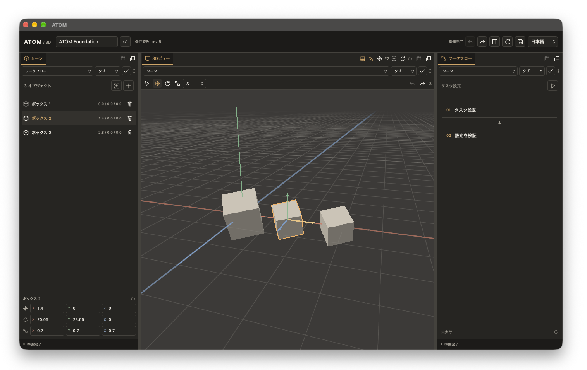

# ATOM



A desktop environment for robot simulation, language-based planning, and learning and evaluating robot policies.

**Implemented:** Tauri 2 / Rust, a native wgpu 3D viewport, docking and floating panels, physics settings, robot templates, and persistent static-mesh imports from Hugging Face / OpenUSD.

Rust owns documents, shared state, and rendering. WebViews send commands and display bounded state snapshots. The interface supports English, Japanese, and Simplified Chinese.

Last updated: October 23, 2026 (JST). LLM connections, training, and continuous simulation playback are not implemented. vLLM-apple and Strata are not connected yet. Selected ThreeX and UNGE sources are copied into `vendor/`, so builds do not depend on the original directories.

## Run

```sh
cd /Users/Shared/Program/Tauri/ATOM
cargo run --locked -p atom-desktop
```

Install Rust and the platform-specific Tauri development prerequisites. There is no Node.js build step.

By default, ATOM uses `workspace.atom.json` in its application data directory. To choose another location, use:

```sh
cargo run --locked -p atom-desktop -- --project /absolute/path/project.atom.json
```

Create the parent directory first.

```sh
cargo run --locked -p atom-cli -- init /tmp/example.atom.json "My Lab"
cargo run --locked -p atom-cli -- inspect /tmp/example.atom.json
cargo run --locked -p atom-cli -- validate /tmp/example.atom.json
```

`validate` generates and validates eight task specifications. It does not run physics or training.

- [Implementation scope and validation results](docs/FOUNDATION.md)
- [Docking controls, structure, and limitations](docs/DOCKING.md)
- For a macOS development app, run `python3 scripts/build-dev-app.py` to create `target/debug/ATOM.app`. This is not a signed distribution build.

## Workspace and 3D controls

Scene, Workflow, and 3D View support tab groups, nested horizontal and vertical splits, resizable dividers, and floating windows.

Drop a tab in the center of another panel to merge it, on an edge to split it, or outside the window to float it. The 3D View can also float. Use the group icon to float an entire tab group; groups can return together. Layout, active tabs, selection, and native window positions and sizes persist across restarts.

Directional and ambient lighting, warm neutral materials, selection outlines, an adaptive XZ grid, and world axes help inspect the scene.

| Action | Control |
|---|---|
| Orbit | Left drag outside joint handles, or Alt + left drag |
| Pan | Right or middle drag, or Shift + left drag |
| Zoom | Mouse wheel |
| Focus selection | F or the focus icon |
| Pose a joint | Drag its colored arc, gold angle ray, or short rotation axis |
| Move object | W |
| Rotate object | E |
| Scale object | R |
| Camera / selection mode | V |
| Undo / Redo | Command + Z / Command + Shift + Z; use Ctrl on Windows and Linux |

Select objects in the viewport or Scene list. Transform objects with axis handles or the XYZ inspector. Undo/Redo is shared across windows and retains up to 128 edits per session.

## Gravity, materials, and robot templates

In the Scene panel, open Environment to choose Earth, Moon, Mars, zero gravity, or numeric XYZ gravity. Physics gravity uses Z-up coordinates; the viewport and object placement use Y-up coordinates.

Select an object to edit its material, density, and sliding, torsional, and rolling friction under Physical material. Choose Floor under Apply to to edit floor friction. Numeric changes select Custom and support saving, reloading, and Undo/Redo. Floor contact, fixed objects, and robot templates are also editable and persistent.

Use the template selector and + button to add a robot:

| Template | Structure |
|---|---|
| Humanoid | 99 links, 98 articulated connections, and 182 rotational degrees of freedom, plus 6 floating-base degrees of freedom |
| Dual arm | 13 links, 6 joints per arm, and a fixed base |

The detailed humanoid includes a segmented spine, neck, jaw, shoulders, arms, hands and fingers, hips, legs, feet, and toes. Connection counts and rotational degrees of freedom are separate quantities. This is an engineering approximation, not a medically complete anatomical model or a universal human joint count. Existing simplified humanoids are preserved; add a new humanoid template to use the detailed model.

These generic box-link models have bounded position servos that hold the authored joint angles. They do not include learned walking, balance, or grasp policies. Selecting the root allows focusing the entire robot; deleting the root removes the whole robot.

The inspector displays the robot's connection and rotational DoF counts and the selected link's axes and angular limits. Choose a joint from the dropdown and edit each axis using a slider or a numeric angle in degrees. The 3D pose updates live while dragging. Release the slider to commit the entire drag as one undoable edit. Escape, pointer cancellation, or window blur restores the pose from before the drag. Numeric fields commit on Enter or blur. Reset an axis with its reset icon. Limits are enforced in both the GUI and Rust. Descendant links follow the edited joint, and angles support saving, restoring, and Undo/Redo across windows.

Selecting a non-root joint also displays its pivot, rotation axes, and angular limits in 3D. Red, green, and blue arcs correspond to local X, Y, and Z; end caps mark the limits and gold rays show current angles. The dragged axis is emphasized. Drag a colored arc, its gold current-angle ray, or the short rotation axis directly in the 3D View to edit the joint. Clicking a handle preserves the current angle; movement is clamped to the joint limits. Release commits one undoable edit; Escape cancels the entire drag. Leaving the viewport, losing window focus, resizing, or changing the layout also cancels it. Joint handles take priority over camera and geometry gestures; Shift + left drag still pans, and Alt + left drag still orbits. Guides remain visible over geometry; their display radius is not a physical reach envelope. They are hidden during physics previews. Edit angular limits with the Lower and Upper numeric fields, or drag the cyan inner lower-limit grip and magenta outer upper-limit grip in 3D. Limits must stay within −180° to 180°, with lower < upper. The grips remain separate even at coincident full-turn endpoints. Narrowing the interval clamps the current angle when needed; the bounds and corrected pose are saved and restored together, and one Undo reverses both. During a limit drag, widening the interval back restores the original angle when it fits again. Release commits one edit; Escape restores the original bounds and pose. Joint-pivot editing remains planned.

Open **Position IK** below the joint controls to move the selected part's center to a world-space XYZ target in meters (Y up). Choose an ancestor as the fixed chain base, enter the target, then click the target icon or press Enter. The reset icon copies the current center; Escape restores an uncommitted target field. Only joints on the path below the base are solved, within their edited limits. Other descendants follow their parent through FK. Successful angles form one Undo/Redo entry and persist in the project. Already-reached targets do not add history; a failed search leaves the pose unchanged. The Rust solver combines bounded CCD with damped least-squares refinement, deterministic restarts and a 1 mm position tolerance. It runs outside the native UI thread. This is a local, position-only authoring solver: failure does not prove a target is unreachable, and orientation, collisions, balance, live target dragging and general time-based robot control remain planned. The bounded Reach reference controller below is implemented.

Use the MuJoCo play icon in Workflow for a bounded physics preview, then reset to restore the authored scene. Preview durations are 0.002, 1, or 2 seconds; the viewport shows the final pose without changing the saved document. Simulation starts from the authored joint pose and uses those angles as servo targets. MJCF exports include an `authored` keyframe for nonzero joint poses; select that keyframe when using the export in another MuJoCo application.

The Python `mujoco` package is required for simulation. ATOM uses `python3` by default; set `ATOM_MUJOCO_PYTHON=/absolute/path/to/python` to use another environment. Editing, saving, and MJCF export remain available without MuJoCo. Models and dependencies are not installed automatically.

```sh
# Create new template projects without overwriting existing files.
cargo run --locked -p atom-cli -- template /tmp/humanoid.atom.json humanoid
cargo run --locked -p atom-cli -- template /tmp/dual-arm.atom.json dual_arm
cargo run --locked -p atom-cli -- export-mjcf /tmp/dual-arm.atom.json /tmp/dual-arm.xml
cargo run --locked -p atom-cli -- simulate /tmp/dual-arm.atom.json 500
```

The repository includes a [humanoid project](templates/humanoid.atom.json) and [MJCF](templates/humanoid.xml), plus a [dual-arm project](templates/dual-arm.atom.json) and [MJCF](templates/dual-arm.xml). These hand-authored box models do not depend on external robot assets. See the [implementation and validation record](docs/FOUNDATION.md) for details.

## Seeded Reach and Episodes

The Workflow panel contains **Reach · 0g**. Add a dual-arm template with +, select its root, enter a seed and step limit, then reset. The first non-root leaf (the left gripper in the shipped template) is the endpoint. A green marker shows its target center in world meters, Y up. The task isolates the chosen robot, keeps its materials, floor and authored starting joint pose, and uses **zero gravity**. Other objects are excluded. The original document, gravity, dirty state and Undo history remain unchanged; the return icon restores the editor scene. Reset/load also focuses the task robot in the 3D View.

Each step continues the same MuJoCo `MjData` for 10 physics ticks of 0.002 seconds. Reset restores authored qpos, zero velocities, controls and solver state; SplitMix64-v1 maps the seed to bounded reference joint goals, and FK determines the target. The default reference controller sends these position-servo goals. It is a privileged baseline, not a learned policy or an IK planner. Rust APIs also accept explicit joint-position actions in radians, in the manifest's channel order; each channel records its qpos/qvel index. Invalid actions do not advance physics or append frames.

Success requires five consecutive post-action observations within **3.5 cm** of the target. The control-step horizon is 1–500 (default 300); success takes precedence when it coincides with the horizon. The task stops stepping and closes its worker on success/timeout. Run advances to a terminal outcome, bounded by a 15-second wall-clock budget plus the current step's at-most-3-second reply wait; worker startup allows 15 seconds. Worker errors preserve the last valid partial record and require reset. Run does not offer interruption/pause in this version; use single steps to control progress. Replay has separate play/pause controls.

The save icon writes an immutable `episodes/reach-<id>-<step>.episode.json` checkpoint beside the project. Refresh/load chooses a saved record; the slider seeks, and play/pause replays recorded poses at their 0.02-second cadence. Playback is Rust-owned and shared across docked/floating views. Loaded records are read-only and **do not require MuJoCo**. They cannot resume a live solver; reset starts a new episode. A live recording can seek/replay its history and continue stepping after returning to its last frame.

Episodes embed the task scene, source hash and optional in-app source revision, exact model hash, seed/profile, joint-channel mapping, reference controls, fixed timing and termination rules. Frame 0 records reset without an action. Later frames pair the action held over `(previous.time, time]` with the resulting qpos, qvel, endpoint, object poses, distance and outcome. Engine, Python and OS/architecture metadata are recorded. Running checkpoints are explicitly partial, not completed trials. SHA-256 verification, bounded reads, semantic validation, synchronized temporary writes and atomic no-clobber publication reject truncated or inconsistent files. Checksums detect damage; they are not signatures.

```sh
export ATOM_MUJOCO_PYTHON=/absolute/path/to/python-with-mujoco
cargo run --locked -p atom-cli -- reach-run templates/dual-arm.atom.json /tmp/reach-a.episode.json 7 300
cargo run --locked -p atom-cli -- reach-run templates/dual-arm.atom.json /tmp/reach-b.episode.json 7 300
cargo run --locked -p atom-cli -- episode-compare /tmp/reach-a.episode.json /tmp/reach-b.episode.json
# Read a recorded frame without a physics runtime.
cargo run --locked -p atom-cli -- episode-replay /tmp/reach-a.episode.json 0
```

Comparison excludes the unique episode ID and checks exact manifest/frame equality, returning a nonzero exit status on differences. Recorded playback is distinct from physics rerunning. Ten seeds, each run twice with MuJoCo 3.1.6 in the development environment, produced identical transitions; all ten reached success in this profile. Seed 7 succeeded after 24 control steps (0.48 s); a one-step horizon produced timeout. These are reference-controller checks, not evidence of learned-policy performance or cross-version determinism. Gravity-loaded control, arbitrary scenes/robots, collision-aware goal generation, streaming cancellation, solver-state resume, branching, PlanTrace and learning-data export remain planned. Native Tauri IPC and OS-event QA remain pending; UI tests use the real Rust core/MuJoCo through a temporary HTTP host, and rendering is tested on Metal offscreen.

## Hugging Face / OpenUSD

Choose a source under OpenUSD · SimReady in the Scene panel. For Hugging Face, enter a dataset repository (default: `nvidia/simready-assets`), revision, and package name. Use the list icon to fetch the catalog and + to import. For local USD, enter an absolute path.

USD, USDA, and USDC are supported. The official OpenUSD SDK composes references, payloads, and their dependencies.

Create the dedicated ATOM SDK environment with the following command. It is already installed in the current development environment.

```sh
sh scripts/setup-usd.sh
# Use a different OpenUSD SDK environment.
ATOM_USD_PYTHON=/absolute/path/to/python cargo run --locked -p atom-desktop

cargo run --locked -p atom-cli -- catalog nvidia/simready-assets
cargo run --locked -p atom-cli -- import-hf /tmp/asset.atom.json nvidia/simready-assets box_cardboard_a01
cargo run --locked -p atom-cli -- import-usd /tmp/local.atom.json /absolute/path/asset.usda
```

ATOM imports public SimReady v1 packages containing one root USD asset. It pins the commit, verifies the bill of materials and file hashes, and retains licensing information. Original USD files and dependencies are cached in `.asset-cache` beside the project. Display meshes are embedded in the project, allowing saved documents to reopen offline. CLI imports append to a project and save it.

Current support is **static-mesh display at frame 0**. Rust/wgpu retains and renders meshes with coordinate and unit conversion, standard instances, and base colors. Imports support transforms, persistence, and Undo/Redo.

Imported articulations remain fixed in their displayed pose. Texture and MDL rendering, full USD physics conversion, articulated control, and USDZ support remain planned. MuJoCo contacts use a convex-hull approximation. The asset's information icon lists approximations and unsupported features. Source, revision, and license metadata are saved; original license text remains in the cache.

## Architecture and planned training pipeline

Tauri 2 provides the UI shell, Rust owns Document / State, and wgpu handles native 3D rendering. ThreeX supplies rendering code; UNGE supplies workflow execution and macOS panel-composition references. The current foundation integrates a native ThreeX viewport and UNGE task-specification validation.

The planned training pipeline starts with small tabletop-arm tasks in MuJoCo on macOS. Simulation records will support LoRA fine-tuning of small language models and evaluation on held-out conditions. vLLM-apple is intended for lightweight local inference, while Strata will provide teacher and planning candidates. Separate MLX or PyTorch workers will update model weights. Job management and these runtime integrations remain planned.

The following design documents are primarily in Japanese:

- [System architecture](docs/ARCHITECTURE.ja.md)
- [Runtime integration design](docs/RUNTIME-INTEGRATION.ja.md)
- [ThreeX / UNGE integration design](docs/REFERENCE-INTEGRATION.ja.md)
- [Implementation roadmap](docs/ROADMAP.md)
- [Research sources and open questions](docs/RESEARCH.md)
