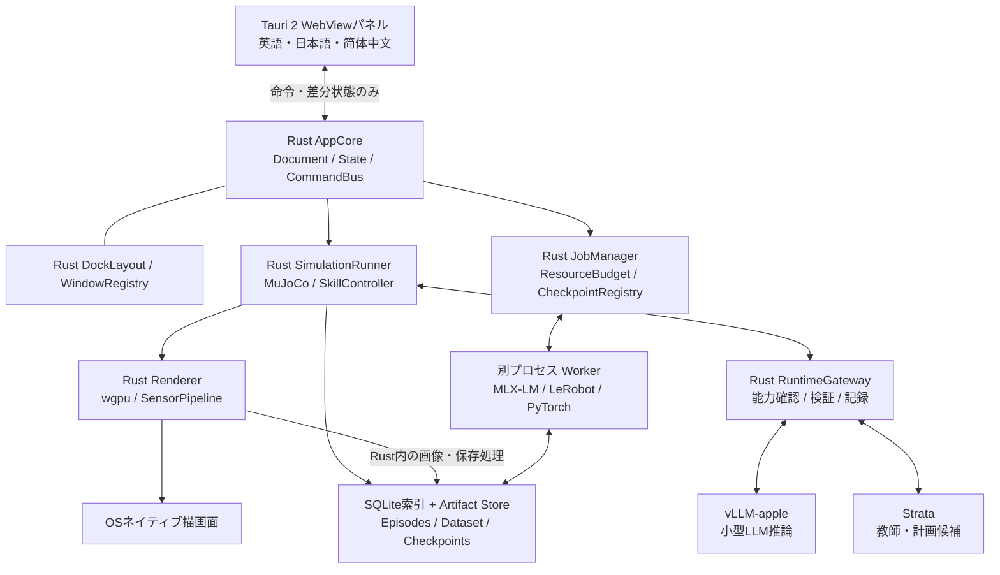

# ATOM システム設計

設計日：2026-10-23（JST）。状態：完成形の設計。現在のベース実装範囲は[FOUNDATION.md](FOUNDATION.md)を参照。
外部仕様の根拠は[調査記録](RESEARCH.md)、ローカル実装との接続根拠は[接続設計](RUNTIME-INTEGRATION.ja.md)を参照。
以下の速度・件数・閾値は初期設計値であり、測定済み性能ではない。
実装済みのタブ・縦横分割・グループフローティング・位置復元・陰影描画の所有権と制限は[DOCKING.md](DOCKING.md)を参照。

ThreeX／UNGEの閲覧後、描画・ノード編集・ウインドウ合成を既存実装から組み立てる方針へ具体化した。
依存版、所有権、実装済み範囲と不足は[再利用設計](REFERENCE-INTEGRATION.ja.md)を参照。

## 1. 最初に成立させる体験

ユーザーが「赤いブロックをトレーに移す」と指示し、仮想ロボットが行動する。
成功・失敗を記録して学習用データに変換し、小型LLMの計画能力を追加学習する。
学習前後を同じ未学習課題で評価し、成功率・所要時間・不正な指示の割合を比較する。

最初の仮定は、Apple Silicon Mac、卓上アーム1台、剛体ブロック、トレー、固定カメラ1台。
ロボット機種は未指定なので、初期検証にはプリミティブ形状の小型アームを使う。
その後、ライセンスと関節・慣性・駆動仕様を確認したSO-101相当などのモデルを追加する。
歩行、柔軟物、多数ロボット、実機操作はこの一巡の後に扱う。

「LLM学習」は既存モデルへの追加学習を指す。基盤モデルのゼロからの事前学習は初期対象外。
シミュレーションの実行やプロンプト改善だけでは学習完了とせず、重み更新と再評価までを成果にする。

## 2. 推奨技術と選定理由

| 層 | 採用方針 | 判断理由・境界 |
|---|---|---|
| デスクトップ | Tauri 2 + Rust | 指定構成。プロジェクトとジョブの正本をRustに集約 |
| UI | TypeScript + Vite + Svelteを初期候補 | パネル操作に限定。学習・物理・描画計算を置かない |
| 描画・画像前処理 | Rust + wgpu、ThreeX rendererを初期候補 | 3D表示を再利用。学習センサー・合成層はATOMで追加 |
| 学習ワークフロー | UNGE core／executor／render | DAG編集・段階実行に利用。固定周期の物理制御は専用Runner |
| 初期物理 | MuJoCo CエンジンをRustから使用 | 関節・接触を扱い、描画と独立して固定刻みで進められる |
| Rustバインディング | mujoco-rsの物理機能を候補に検証 | 公式C ABIと対応する版を固定。既存OpenGLビューアーは使わない |
| LLM推論 | vLLM-apple / Strataアダプター | 既存のHTTP API・資源制約を尊重 |
| LLM追加学習 | 独立MLX-LM Worker | Macの小型モデルLoRAから開始。ランタイムのPython環境と分離 |
| ロボット方策学習 | LeRobot / PyTorch Worker | ACT等の模倣学習を基準に、SmolVLA等のVLAへ拡張 |
| ローカル索引 | SQLite WAL | ジョブ、実験、アセット、チェックポイントの索引 |
| 大容量保存 | ファイル + Parquet + 動画 + safetensors | DBやWebViewに動画・重みを格納しない |
| 遠隔処理 | バージョン付きHTTPS API + ジョブキュー | Linux GPU環境を後から追加できる境界 |

MuJoCoのCPU物理を最初の基準にし、wgpuは描画・センサー画像処理に使用する。
接触ソルバーまで初期段階で自作することは避ける。
MuJoCoのMJX／Warp、Genesis、Isaac Lab／Newtonは別バックエンド候補とし、同じ性能・物理挙動を仮定しない。
2026-10-23の再調査ではIsaac Lab 3.0正式版を確認した。Newton／OV Librariesによるkit-less構成と物理・描画・可視化の分離を採用判断に反映し、Isaac Sim必須という前提にはしない。
公式導入経路はWindows／Linuxを対象としており、Macの初期必須依存にはしない。[S1–S5]

RoboCasa365はエンジンと区別し、公式robosuite環境・課題・データ・評価を保持するTaskSuiteAdapterとして接続する。
共通契約、M0-A〜M7の実装順、公式評価と研究profileの分離は[追加ロードマップ](ROADMAP.md#統合ロボット学習環境への拡張設計)を設計上の基準とする。

## 3. 全体構成



Pythonは学習ライブラリと将来の特殊な物理Workerの境界で利用する。
Document、編集状態、ジョブ状態、GUI、ローカル描画はRust／Tauri側に残す。
MLX／PyTorchのテンソル計算は各ライブラリのネイティブGPU実装に委譲し、wgpuで再実装しない。

## 4. Document / State / Rendererの所有権

- `ProjectDocument`：シーン、ロボット、タスク定義、学習設定、アセット参照。変更履歴とスキーマ版を持つ。
- `AppState`：実行中ジョブ、選択対象、再生位置、接続状態、DockLayout。Rustだけが更新する。
- `SimulationRunner`：MuJoCoのmodel/dataを専用スレッドが所有。非同期処理から直接触らない。
- `Renderer`：GPU Device/Queue、メッシュ、材質、センサー出力、ウインドウ別Surfaceを所有。
- `WindowRegistry`：各ウインドウはwindow_idと購読先を持つ。Documentや実験状態を複製しない。

UNGEのgraphはEngineが唯一の可変所有者となり、ProjectDocument側は参照を持つ。
ThreeX Sceneは物理状態から作る描画用の派生データとし、tick更新を永続編集履歴へ流さない。
3D表示とノード表示はRenderServiceが個別textureへ描画させ、ATOMのwgpu合成層で配置する。
両rendererの既存clear処理を同じSurfaceへ直接重ねない。

WebViewはrevision付きの読み取り用投影と、hover／入力途中などの一時的な表示状態だけを持つ。
更新は`Command { id, project_id, expected_revision, kind, payload }`でRustに送る。
競合する編集は拒否して最新snapshotを返す。受信漏れはrevisionの欠番で検出する。
ウインドウを閉じてもジョブを失わず、アプリ全体の終了時は停止またはcheckpoint保存を管理する。

物理は固定刻み、描画は別周期、UI状態は必要な差分だけを間引いて送る。
物理と描画間は有界バッファを使い、表示用の古いsnapshotは破棄可能にする。
学習データは黙って欠落させず、書き込み遅延時に生成を減速・停止する。

## 5. ネイティブ描画とドッキング

2026-10-23実装：親WindowのThreeX Surfaceと子WebViewを同居させ、3パネルのタブ・入れ子分割・個別／グループフローティングを実装した。配置v3と独立したホスト位置保存により、選択・並び順・位置・サイズを復元する。単一Rendererで全ホストのSurfaceを切り替え、面法線による陰影を描画する。
配置はRustのLayoutStateが保持し、同じWebViewをreparentする。GraphのGPU描画、任意分割とTabsは今後の設計。
現在のAPI・検証・制限は[DOCKING.md](DOCKING.md)。以下は拡張を含む設計方針。

Tauriの標準WebViewにwgpuのTextureをそのまま渡せるとは仮定しない。
Wryにはwgpuとの併用例がある。[S6–S8]
加えてUNGEにはmacOSでの合成と1パネルの切り離しの実装・検証記録があるため、これを初期統合の基準にする。
ATOMへの組み込み、複数パネル、OSごとの重なり・入力・再配置は独立した検証事項。

初期スパイクでは、同一ウインドウ内のネイティブ描画領域とWebViewパネルを重ならない領域に配置する。
macOSのNSView/CAMetalLayerを含む表示面の生成・破棄はメインスレッドで扱い、GPU処理はRendererに集約する。
JSは描画領域の論理座標・サイズ・DPI変更と操作命令を通知し、画像を受け取らない。
ドラッグ、右クリック、ホイール、IME、Retina、最小化、画面間移動、Surface再生成を実機確認する。

各パネルはRust管理の`DockNode = Split | Tabs | Panel`で配置し、独立ウインドウへの切り離しと再結合を扱う。
フローティング後も同じpanel_id／document_idを参照する。配置は保存し、存在しないディスプレイへの復元を補正する。
ビューの切り離し時にはSurfaceを再作成できるが、DocumentとGPUアセットの所有者は変えない。

ネイティブ埋め込みが成立しないOSでは専用Viewportウインドウを開発中の代替にする。
ただし「ドッキングまで完成」とは扱わず、埋め込みが通るまで当該要件は未完了。
透明WebViewの全面重畳は初期の前提にしない。
UNGEの実例を利用するmacOSホストでは、版固定のTauri unstable APIをWindowComposition adapterへ局所化する。
両repoのTauri固定版が異なるため、core／rendererを選択してATOMの単一ホストで統合する。
初期wgpu候補は両repoが使う27.0.1とし、新majorへの更新は統合検証と分ける。

## 6. 仮想環境と制御

### 初期タスク

1. Reach：指定位置へ手先を動かす。
2. Pick：接触と把持を確認して持ち上げる。
3. Place：対象領域に配置し、把持を解除する。
4. Sequence：色・対象・順序を変えた指示を計画して実行する。

初期のLLMには、シミュレーターのobject_id・姿勢・到達可能性などの構造化観測を渡す。
これはground-truth観測を利用する計画実験であり、視覚認識による自律操作の達成とは区別する。
VLA評価では方策への入力から正解物体状態を除き、RGB・関節状態・言語指示など許可した観測だけを使う。

初期周期案：物理500 Hz、関節制御50 Hz、センサー20 Hz、Viewport 30〜60 Hz、UIテレメトリー最大10 Hz。
LLMは課題開始時・スキル終了時・失敗時に呼び、サーボ周期では呼ばない。
LLM待機中のシミュレーション停止を初期モードとし、実時間評価モードとは結果を分ける。
実時間モードではタイムアウト時に安全な保持／停止へ移行し、古い計画を適用しない。

LLMの出力は最大16手の`SkillPlan`とする。
例：`move_to(object_id)`、`grasp(object_id)`、`place(target_id)`、`wait(duration)`。
RustのIK・軌道生成・関節制御が数値動作へ変換する。自由文や生成コードを直接実行しない。
Schema、対象の存在、前提条件、ワークスペース、関節速度・力・時間上限を検証する。
`run_id / episode_id / observation_tick / plan_id`を照合し、リセット前の応答を破棄する。

座標は右手系・Z-up・SI単位を基準とし、quaternion順序、関節順序、actionの絶対／差分表現をスキーマに明記する。
URDFの入力ではMuJoCoに必要な慣性・駆動・接触設定の欠落を検出する。見た目が読み込めただけで物理互換と判定しない。
初期の保存正本はMJCFと資産manifestとする。

### 重力・物性・媒質の拡張予定

🟠 [Next] RustのProjectDocumentに`PhysicsSpec`を設け、`GravitySpec`、`PhysicalMaterial`／`ContactPair`、`MediumSpec`を保存する。地球・月・火星・無重力のpresetと数値ベクトル、物体ごとの素材・摩擦、密度・質量・慣性を扱う。見た目の素材と物性を分離し、Y-upの編集座標からZ-upの物理座標への変換をRustで行う。Inspector、CLI、外部AIは同じ命令と履歴を使い、各ウインドウは状態を所有しない。

🔴 [Later] 重力と媒質を独立に選べるようにし、水中の浮力・抵抗・部分浸水から、自由表面を持つ液体と剛体の連成へ進める。粒子・格子・センサーの大容量データはRust／Worker／GPUに保持する。設定の保存だけで物理対応完了とは扱わず、backendへ適用した値と検証結果を記録する。詳細と受け入れ条件は[ロードマップ](ROADMAP.md#重力素材摩擦液体の設定)を正本とする。

### 外部AIの制御入口

🟠 [Next] Rust Control APIにローカルIPC経由の`atom-mcp` bridgeを接続する。外部AIとGUIが共有Documentを操作し、能力照会、設定検証、実験実行、job停止、結果取得を共通化する。revisionとidempotency keyで競合・重複を防ぎ、切断後もjobを追跡する。ATOMから推論を依頼するRuntimeGatewayとは責務を分ける。

🔴 [Later] 遠隔Streamable HTTPと各社AIのfunction calling bridgeを追加する。接続profileは製品・版ごとに実測し、未検証の接続は⭕️ [Pending]とする。API案・認可・資源制限・三言語の導入支援は[ロードマップ](ROADMAP.md#mcp主要aiからのアクセスと制御)を参照する。

### 実装済みのOpenUSD資産経路

Rustの`assets`がSDK Workerの実行・中止・時間上限を管理し、取り込み中の共有文書をrevision付きで予約する。Hugging Faceは公開datasetのSimReady v1 packageをcommitに固定して取得し、BOM／各ファイルのSHA-256を検証。ローカルUSDは親フォルダー内の依存を検証してコピーする。元データはプロジェクト横の`.asset-cache`に保持する。

schema v3のProjectは、`SceneObject.mesh_ref`、Arc共有の不変`TriangleMesh`、出典・license・SDK版・変換上の近似を保持する。保存文書には表示メッシュを含める。UI Snapshotは資産summaryと物体の参照・姿勢だけを返し、頂点・index・textureを渡さない。wgpuはhashで共有するGPU bufferを所有し、変形ではinstance行列だけを更新する。ThreeXのコピー済みrendererに追加した経路であり、元ThreeX repoは変更していない。

現在はフレーム0の表示形状を単一静的メッシュへ合成する。通常instance、単位・座標、Mesh／Cubeを対象とし、関節は表示姿勢で固定する。MuJoCoへのmeshは凸包collisionで、compilerによるmesh座標の補正を表示姿勢から除く。USD physics全体の等価変換ではない。詳細と未対応は[ロードマップ](ROADMAP.md#hugging-faceopenusd2026-10-23)を参照。

## 7. 二つの学習経路

### A. LLMによる作業計画の追加学習：最初の閉ループ

1. 手書きのスキル制御で成功する基準タスクを作る。
2. vLLM-apple／Strataから計画候補を取得し、Rustで検証して実行する。
3. 観測、指示、計画、スキル結果、成功条件、失敗分類を保存する。
4. 成功が機械判定された計画、または修正後に再実行で成功した計画をSFTデータにする。
5. 独立したMLX-LM Workerで小型モデルをLoRA学習する。
6. 学習前モデルと学習済みadapterを同じ評価Workerから実行し、同じ条件で比較する。
7. 合格したモデルをcheckpoint registryへ登録し、対応が検証できた推論入口へ昇格する。

教師の説明は正解として無条件採用しない。成功判定は距離、把持、接触、配置領域、時間制限などのタスク定義で固定する。
LLMは失敗の説明候補を付けられるが、自分の評価指標や合格条件を変更できない。
初期データは指示＋観測から最終SkillPlanを学ぶ。内部思考の収集は必須にしない。

最初は0.5〜3B級を検証候補とし、具体的なモデル・ライセンス・MLX対応・メモリーを確認して固定する。
既存Gemma previewが推論できることと、そのartifactを学習・再配置できることは別条件である。
vLLM-appleの固定hash gateを変更して学習済み重みを通す実装にはしない。
MLX-LMはLoRA／QLoRAを提供するが、対象モデルと依存版で短い学習・保存・再読込を先に検証する。[S11]

### B. ロボットの動作方策：後続の閉ループ

教師の軌道・手動操作・成功した制御から状態とactionの時系列を作る。
まずBC／ACT等を基準にし、画像と言語で操作するSmolVLA等を比較対象に追加する。
VLAは一般のchat APIではなく、観測テンソルからaction chunkを返す専用Workerに接続する。
LeRobotはこの時系列データと方策学習の候補であり、vLLM-apple／StrataがVLAのaction headを実行できるとは仮定しない。[S9–S10]

学習順序はSFT／模倣学習から始め、比較基準を確立してからPPO・SAC・選好学習などを追加する。
LLMのDPO等と連続制御のRLは、目的関数も必要なデータも異なるジョブ種別にする。

## 8. データと評価契約

| 記録 | 主な項目 |
|---|---|
| RunManifest | schema版、ソースrevision、依存lock hash、物理／描画backend、OS・機器、モデルhash、seed |
| Episode | task版、scene hash、初期配置、domain randomization、開始／終了、成功判定、打ち切り理由 |
| Step | simulation tick、単調時刻、関節状態、観測参照、action、reward、terminated／truncated |
| PlanTrace | 使用モデル・prompt/template版、計画JSON、検証結果、使用可能な観測、実行結果 |
| Checkpoint | baseモデルhash、tokenizer、adapter、学習設定、optimizer等の再開情報、dataset hash、評価結果 |

言語計画データはJSONL、数値軌道はParquet、画像はRust側でエンコードして保存する。
外部交換にはLeRobotDataset v3を使い、公式loaderで読めることを互換性の受け入れ条件にする。[S9]
直接v3の内部構造を手書きするより、版固定のexport Workerで変換する。
LLM用JSONLとロボット時系列を同一形式とみなさず、episode_idで追跡できるようにする。

画像はwgpuのオフスクリーン出力を使う。記録やPythonへの入力でCPU readbackが必要な場合は、
Rust側の有界staging buffer→共有メモリー／ファイルへ送る。ゼロコピーを保証せず、転送量と遅延を測る。
JSへ生RGB、depth、点群、重みを転送しない。動画確認もネイティブ再生面を基本とする。
センサー画像にはcamera intrinsics/extrinsics、色空間、depth単位、frame tickを付ける。

データ分割はframe単位ではなく、scene family・配置・指示templateのグループで行う。
同じ軌道の翻訳・言い換えをtrainとtestに跨がせない。正規化統計はtrainのみで算出する。
記録途中のデータはtemporary領域に置き、manifestとhashの確定後に索引へ公開する。

評価は固定した未学習seedとタスク群で行う。学習中のモデル選択にはvalidationだけを使う。
最終testは固定して一度比較し、繰り返し使った場合は開発用へ降格して新しいtestを用意する。
初期比較案は100 episode以上、学習seed 3本。小規模smoke結果とは区別する。
成功率の区間推定、paired差分、不正行動率、衝突、wall-clock／simulation time、推論待ち時間を保存する。
重み更新・再読込が通っても、統計的な改善を確認できなければ「学習経路は動作、改善は未確認」とする。
物理の完全なbit一致をOS・GPU間で保証せず、同一構成での再現性と許容誤差を別途定める。

## 9. ジョブ管理とメモリー

ジョブ状態は`queued → preparing → running → checkpointing → succeeded / failed / cancelled`。
キャンセル要求は独立フラグとして扱い、checkpoint可能な境界で停止する。
Worker停止時にはpartial成果物を隔離し、retryはidempotency_keyで二重登録を防止する。
再開では重みだけでなくoptimizer・乱数・step・dataset位置が揃うか確認する。

初期はGPUを大きく使う処理を一つずつ実行する。
教師生成→保存→教師の使用終了→学習→評価の順に進め、同時常駐を前提にしない。
ATOMのResourceBudgetはOS余裕、renderer、モデル、KV、optimizer、activation、動画queueを見積もる。
vLLM-apple内の予約管理をシステム全体のメモリー予約APIと誤認しない。
外部起動されたランタイムをATOMが勝手に停止せず、余裕が足りなければジョブを待機させる。
実際の搭載メモリー・GPU利用可否は初期診断で測る。本調査のsysctlは権限制限で取得できなかった。

## 10. 画面構成

中央にViewport／Workflowの切り替え、左にScene／Assets、右にInspector、下にTimeline／Episodes／Jobsを置く。
WorkflowはUNGEのノード編集で、Rollout→検証→Dataset→学習→評価の処理を組み立てる。
上部は再生・一時停止・1 step・記録・学習・停止のアイコン中心にまとめる。
説明は情報アイコンのhover／focusで表示し、操作名はtooltipとアクセシブル名に持たせる。
処理状態・失敗理由・費用など判断に必要な情報は短い文字でも表示する。

狭いウインドウではパネルをタブ化し、Viewportを潰して全欄を横並びにしない。
英語・日本語・简体中文のキーを初期から揃える。動的エラーもcode＋引数で翻訳する。
日本語の不自然な改行、中国語の禁則、長い英語ラベルを実画面で確認する。
キーボードでパネル移動・閉じる・再配置・復元ができるようにする。

## 11. ファイル・プロセス境界

Tauri capabilityは必要なRust commandに限定する。WebViewへ汎用shellや外部サービスの鍵を公開しない。
Workerは固定entrypoint＋検証済み引数で起動し、LLM出力をshellへ渡さない。
ローカル通信はloopback／UDS、外部通信はHTTPSと認証を使用する。
認証情報はOSの資格情報保存領域または権限制限したファイルに置き、実験データ・ログから除外する。
外部モデルやsceneのコード・プラグインを自動実行しない。
モデル、dataset、meshごとに入手元・revision・licenseを記録して配布可能性を確認する。

## 12. 将来の共有基盤

初期はローカル完結にし、クラウドを必須にしない。
チーム共有・長時間バッチが必要になった段階で、XServer VPS Cloudを中核にする。

- App VPS：認証、実験API、ジョブ受付、成果物索引API。
- Managed PostgreSQL：ユーザー、ジョブ、実験索引。接続はCloud内API側から行う。
- NFS：Cloud側の共有成果物。モデル・動画の容量とI/O要件を測定して採否を決める。
- 通常VPS Worker：データ変換、クロール、CPUバッチ。HTTPS／ジョブキュー経由で接続。
- GPU Worker：利用可能なMac／Linux GPU機。HTTPSでleaseを取得し、必要な成果物だけ転送する。

通常VPSやGPU WorkerからManaged DB／NFSへの直接接続に依存しない。
XServerのGPU提供を前提にせず、プラン、通信制限、容量、価格は導入時に確認する。
遠隔シミュレーションでは物理・方策制御をWorker内で閉じ、ネットワーク往復を制御ループに入れない。
映像が必要なら圧縮streamをRustで受信・復号して表示し、UIには状態だけを送る。

## 13. 予定ディレクトリ

以下は将来の配置案であり、現在存在する実装を示すものではない。

```text
ATOM/
  apps/desktop/                  # WebView UI + src-tauri
  crates/atom-core/               # Document, State, commands, schema
  crates/atom-sim/                # Backend trait, scheduler, skills
  crates/atom-sim-mujoco/         # FFI ownership, model import, physics
  crates/atom-render/             # wgpu, sensors, native viewport
  crates/atom-workflow/           # UNGE registry, node executors, job mapping
  crates/atom-runtime/            # vLLM-apple / Strata / evaluation adapters
  crates/atom-jobs/               # worker lifecycle, budgets, artifacts
  crates/atom-data/               # episodes, index, manifests
  crates/atom-cli/                # headless run / evaluate / export
  workers/mlx-trainer/            # isolated environment + dependency lock
  workers/lerobot/                # export / train / policy inference
  assets/scenes/                  # small, licensed fixtures
  schemas/                       # versioned wire and storage contracts
  docs/
```

プロジェクトデータはユーザー指定の`.atom`ディレクトリにmanifest・DB・成果物を分けて保存する。
巨大モデルや生成データはGitに入れない。vLLM-apple／StrataはAPIで利用する。
ThreeX／UNGEは必要なRust crateを選び、開発時path依存と配布時の固定ソース参照を分ける。

## 関節角の文書契約

関節角はRustの`RobotLink.angles`にラジアンで保持し、GUIは度へ変換する。`SetJointAngle`は共通revisionで検証し、上限・下限を越えた入力を拒否する。WebViewは角度の編集中の入力だけを一時保持し、確定した角度・履歴・FK姿勢は所有しない。関節の固定rest支点と形状からRustが子孫リンクの姿勢を導出し、wgpuへ渡す。位置やフレームの大容量転送は導入しない。保存文書はrest形状と角度を別々に持ち、再読込時に同じFKで復元する。

関節の限界は`SetJointRange`でprimary／追加軸に保存し、現在角度のclampを同じversionへ含める。3D端点操作は`JointEdit::Lower / Upper`というtyped previewを使い、owner／tokenと軸を固定する。途中の補正角を次の計算の基準にせず、元文書の角度を毎回新しい範囲へclampする。確定した範囲と姿勢はRustだけが所有し、WebViewは度単位の入力とbounded Snapshotを扱う。
