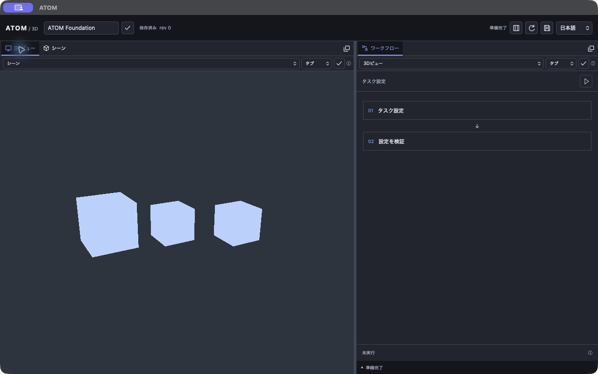
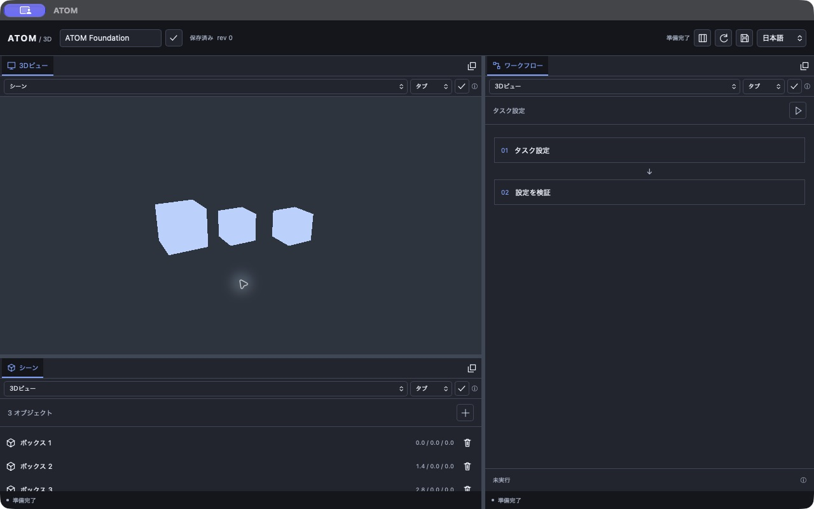
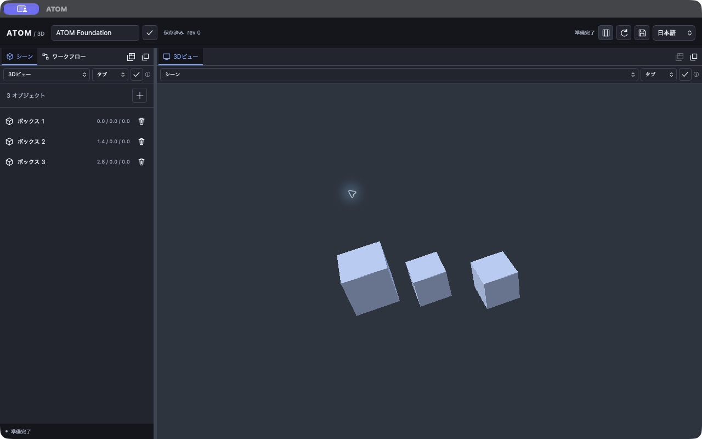
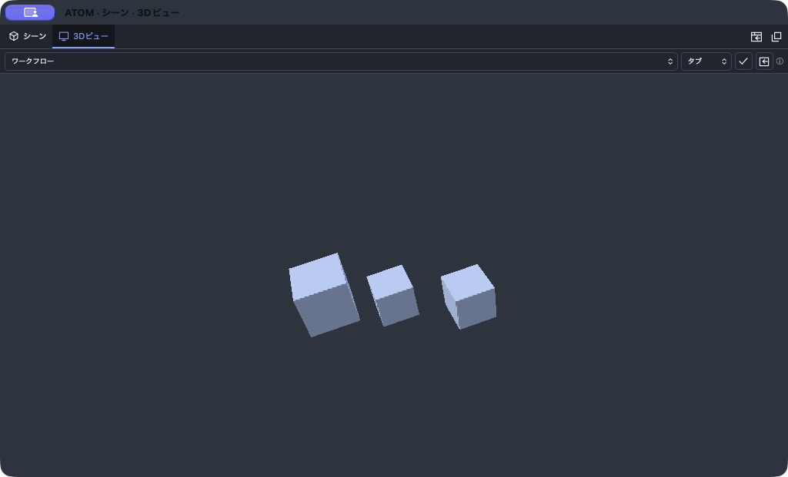
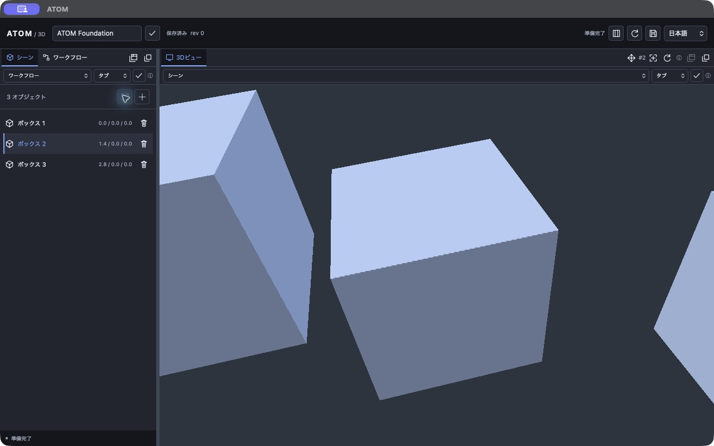
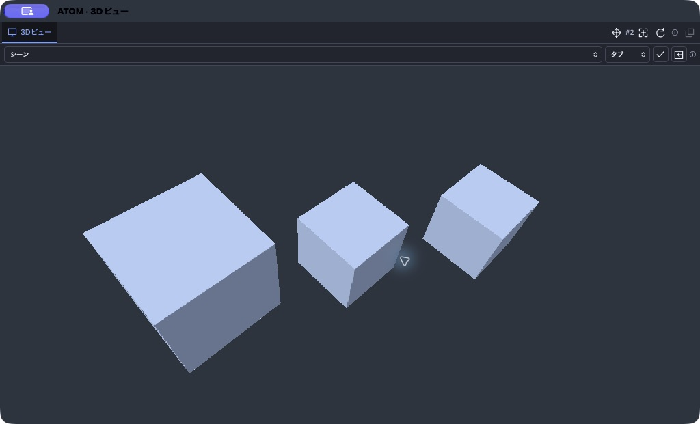

# ATOM native workspace

2026-10-23（JST）。Tauri 2.12.4／wgpu 27.0.1／macOS arm64。

## 操作

- シーン／ワークフロー／3Dビューのタブをドラッグ。移動先パネルの中央へ落とすとタブ結合、四辺へ落とすと上下左右に分割する。
- 非アクティブなタブも直接ドラッグできる。同じグループ内の結合操作では指定したタブの直後へ移る。
- タブをクリックして切り替える。左右矢印／Home／Endでもタブを選択できる。
- 縦横の分割を入れ子にできる。分割境界はドラッグでライブ調整、フォーカス後の矢印キーで2%ずつ調整する。
- ドラッグ中のEsc／ポインターキャンセル／フォーカス喪失で中止する。境界プレビューは保存せず、確定時のみ保存する。
- タブ列右端の切り離しアイコン、またはメイン領域外へのドロップで独立Windowにする。3Dビューも対象。
- タブ列のグループ切り離しアイコンで、並び順・選択タブを保ったまま全タブを一つの浮動Windowへ移す。浮動グループから個別タブだけをさらに切り離すこともできる。
- 浮動Windowの閉じる操作／グループ復帰アイコンはグループ全体をドックへ戻す。下段の復帰アイコンはアクティブなパネルだけを戻す。戻り先がなくなった場合は残るグループへ結合する。
- ドラッグの代わりに、タブ列下の移動先・配置方法・適用アイコンを使える。全パネルを切り離した状態からも復帰できる。
- メインツールバーの配置リセットで標準のシーン／3D／ワークフロー配置へ戻す。

対象は現在の3種類のパネル各1枚。任意の組み合わせ・縦横分割・タブグループのフローティングを扱う。パネル複製、浮動Window内の分割、浮動グループへの直接ドロップ結合は未実装。
復帰時の新しい分割比率は50%。ネイティブWindowの移動・サイズ変更はOSの操作を使う。

## Rustの所有権と描画

Project／SceneはAppCore、配置と言語はWorkspace、GPU資産はPreview内の単一Rendererが所有する。
Window／WebViewは状態の正本を持たない。配置変更はProjectのrevisionと独立し、expected_revisionで競合を拒否する。
Rustのツリーは`Tabs { panels, active }`を葉、`Split { axis, ratio, first, second }`を枝とする。
3パネルの一意性、activeの所属、ID重複、深さ・ノード数、比率、言語を検証したクローンを公開する。
抜けた空グループは削除し、片側だけの分割を畳む。無効・古い命令ではIDやrevisionを消費しない。

UNGEからコピーしたホストのreparent／構成・保存処理を参照し、ATOM固有のツリーへ拡張した。
同じWebViewを移動・非表示にするので、移動やタブ切り替えでワークフロー結果を失わない。
初回ナビゲーションの完了前に復元した非アクティブタブを隠さない。読み込み・サイズ・フォーカス通知をまとめ、reparent中の最後の通知も処理する。
ネイティブ処理はレイアウト遷移ガードで直列化し、OS呼び出し待機中は状態Mutexを保持しない。
reparent失敗時は移動済みWebViewを元の親へ戻す。公開後の表示・保存失敗は状態を通知してエラーを返す。

ThreeXのATOM内コピーに領域描画・背景のみのclear・Surface交換を追加した。
メインと3つの浮動ホストのSurfaceを子WebViewより先に作り、同じAdapter／Device／Queue／Rendererで描画先を交換する。
互換性を検査し、失敗時は両Surfaceを保持する。切り離しでSceneやGPUの頂点・インスタンスバッファを複製・再生成しない。
3Dタブが非表示のWindowは背景のみclearし、以前の3D画像を残さない。clearはSceneのGPUキャッシュを更新しない。
カメラaspect、viewport/scissor、子WebView配置は同じRust geometryから求める。
GPU画像、頂点、モデル重みをJSへ送る経路はない。

ThreeXのコピー内シェーダーは、変換後のワールド位置の微分から面法線を求め、方向光・補助光・環境光を加える。非均等スケールでも面の向きに追従し、追加の頂点／インスタンス転送は不要。カメラを少し見下ろす角度にし、上面と側面を判別できる。現段階は面単位の陰影で、影の投影・PBR・滑らかな球面法線は未実装。

macOSではNSWindowのcontentView／contentLayoutRect／safeAreaInsetsをメインスレッドで取得する。
空Windowへのreparent後、Tauriが子WebViewのサイズをinner_sizeとして返す場合があるため、実際のネイティブcontentサイズを使用する。
ドラッグは捕捉したイベントの論理座標をRustへ送り、親Window・子WebViewの位置とDPIで変換する。
分割境界のプレビューでは入力元座標系を固定し、移動した境界の位置を遅延イベントへ二重加算しない。
GPU Timeout／Lost／Outdatedは再configure・待機表示で扱う。Device Lostの自動再生成は後続。

## IPC

| Command | 入力 | 結果 |
|---|---|---|
| workspace_state | なし | LayoutState |
| workspace_command | Dock / Select / Return / FloatGroup / ReturnGroup / Locale / Reset、expectedRevision | LayoutState |
| panel_drag | panel、preview/drop/cancel、pointer、expectedRevision | 中央／四辺／浮動候補 |
| split_resize | id、preview/commit/cancel、pointerまたはratio、expectedRevision | LayoutState |

ラベルは`toolbar`、`scene`、`workflow`、`viewport`、`split-0`、`split-1`。
パネル命令は呼び出し元自身または同じタブ群のパネルに限定。Locale／Resetはtoolbarだけ。
境界命令は該当split WebViewと現在の分割IDを検証する。境界WebViewはProjectの読み書き命令を使えない。
`atom://layout`で確定状態、`atom://dock-preview`で候補、`atom://viewport`でGPU状態を通知する。
表示キャッシュとポインター操作の一時値以外はRustが保持する。

## 保存と移行

`app_config_dir()/dock-layout.json`にversion 3のツリー、アクティブタブ、浮動グループと固定ホスト、復帰先、分割比率、言語を保存する。
version 1／2はメモリー上で変換し、次の確定操作でversion 3として保存する。旧左右配置・縦積み・浮動モード・言語を引き継ぎ、v2の浮動パネルは単独グループへ移行する。
`ATOM_LAYOUT_PATH`で検証用保存先を指定できる。16KiB上限、未知version／未知フィールド／不正値は元ファイルを保全して標準配置へフォールバックする。
保存は同じディレクトリの一時ファイルへwrite→sync→rename。配置revisionはIPCに含め、起動時に0へ戻す。

浮動Windowは閉じずにhideして再利用し、同一起動中はOSの位置・サイズを維持する。
再起動ではツリー・比率・選択・浮動グループと、そのホストの位置・サイズを復元する。
UNGEのpanel_preferencesを参考に、`dock-layout.windows.json`へホスト別の論理サイズ・モニター作業領域からの論理オフセット・モニター識別を保存する。`ATOM_LAYOUT_PATH`使用時は同じパスの拡張子を`windows.json`へ置き換える。
保存先は配置ツリーと分離し、OSの移動・リサイズで配置revisionや操作中のジェスチャーを無効化しない。約180msにまとめて一時ファイルから置換し、終了時にも同期保存する。
最大化・最小化・フルスクリーン中は最後の通常サイズを保つ。同一モニターは現在のDPIで復元し、切断時は主モニターへ戻して作業領域内に収める。異常・未知形式の保存ファイルは保全する。実DPI切替は未検証。
3つの固定ネイティブホストを再利用し、空いたホストへ新しい浮動グループを割り当てる。グループ内のタブを抜いても残るグループのホストは変わらない。同時起動間では最後の保存が優先。

## 検証

- 🟢 [Done] 通常workspace test：168 passed、0 failed、11 ignored（実GPU5＋benchmark6）。
- 🟢 [Done] 実GPU試験：5 passed。非均等スケールの箱で3面の明暗差をピクセルから検証。領域のピクセル一致、領域外clear、不正領域拒否、背景clear後のScene stamp・GPUバッファ保持と再描画一致。
- 🟢 [Done] ツリー操作1000遷移、中央結合／4方向分割、選択、全浮動／復帰先消失、古いrevision・不正値拒否。
- 🟢 [Done] DPI 1／1.25／2とゼロ・極小サイズで領域の被覆／非重複、v1・v2移行／v3復元／未知version保全、プレビュー非永続化。
- 🟢 [Done] Desktop build、workspace/all-targets Clippy（警告をエラー）、format、JS構文。
- 🟢 [Done] macOS実操作：タブ結合・切り替え、非アクティブタブの下辺ドロップ、縦横の入れ子分割、両方向の境界ドラッグ、矢印キー調整、配置リセット。
- 🟢 [Done] 3Dを含むタブ構成の再起動復元、起動時非アクティブだったタブの表示、英語・日本語・简体中文の同期。
- 🟢 [Done] 初回3D切り離し、復帰ボタン／閉じる操作、浮動3Dの再起動復元、メインSceneへのボックス追加を浮動3Dへ反映。
- ⭕️ [Pending] 狭いネイティブWindow、最小化復帰、実機での跨モニターDPI移動、Windows／Linux。
- 🟢 [Done] 浮動グループの選択・並び順・復帰・個別再分離、ホスト重複回避、不正グループ拒否。
- 🟢 [Done] ウインドウ配置のDPI変更・モニター切断・巨大／画面外座標の補正、異常値拒否、保存ファイル保全の自動試験。
- 🟢 [Done] macOS実操作：シーン＋ワークフロー／シーン＋3Dのグループ化、浮動内タブ切替、OS配置コマンドで1024×621へリサイズ・位置変更、再起動後に位置・サイズ・選択を復元。非選択で復元した3Dの再表示、3Dだけを別ホストへ分離して描画を確認。最終ビルドで全ホストからの配置リセット、グループの閉じる操作による一括復帰、境界の再調整も確認。
- 🔴 [Later] パネル複製、浮動内の分割、カメラの再起動復元、GPU Graph合成。

通常CPU試験と実GPU試験は分けて実行。依存`block 0.1.6`の将来Rust互換性警告は継続。

English: Drag a tab to a panel's center to join tabs, or to an edge to split. Splits can nest horizontally and vertically; drag dividers or use arrow keys to resize. All three panels, including the native 3D viewport, can float and return. A single Rust-owned Scene and GPU renderer survive these moves. Layout v3 adds floating tab groups with active selection and v1/v2 migration. Native geometry is restored using monitor work areas and logical sizes. Group return and individual detachment preserve the shared renderer; directional and ambient lighting distinguish object faces.

简体中文：将标签拖到面板中央以合并，拖到边缘以拆分。支持横向和纵向嵌套分割，可拖动分隔线或用方向键调整。三个面板（包括原生3D视图）均可浮动及返回。Rust持有唯一的Scene和GPU渲染器。v3布局支持整组浮动、选中项与顺序保存，并迁移v1/v2配置。窗口位置和逻辑尺寸按显示器工作区恢复。支持整组返回和单独拆出标签；方向光与环境光使物体各面清晰可辨。

## 3Dカメラと選択（2026-10-23）

- 左ドラッグで選択対象を中心に回転する。選択だけでは回転中心を変更せず、フォーカス操作で中心を対象へ移す。
- 右／中ドラッグ、Shift＋左ドラッグでパン。上段の十字矢印アイコンを有効にすると左ドラッグでもパンできる。
- ホイールでズーム。3Dの描画領域内だけで入力を受け取り、ドックやツールバーのスクロールは対象外。
- シーン一覧のオブジェクト名、または3D内の箱をクリックして単一選択する。背景クリックで解除。選択は一覧の強調と3D上段の番号に反映する。
- フォーカスアイコン／Fキーで選択対象を画面中央へ収める。0キー／リセットアイコンで標準視点へ戻す。キー操作は3D領域または該当パネルで有効。入力欄と他のパネルには割り当てない。
- Escで進行中のカメラドラッグを開始時点へ戻す。領域外・フォーカス喪失・サイズ変更・レイアウト変更ではドラッグを終了する。

カメラと選択はRustの`camera::State`が所有し、ドッキング・浮動・タブ切替を通して共有する。Projectのdirty／revisionを変更せず、プロジェクト保存内容にも含めない。カメラと選択の再起動後の永続化、複数選択、全体へのフィットは未実装。

ThreeXのPerspective／列優先行列とlookAt参照を使い、ワールド上の注視点・距離・yaw／pitchからビュー行列を計算する。パンは画面の右／上方向と距離・FOV・描画高さから計算する。距離と角度を制限して極や対象通過で破綻しないようにする。
フォーカスはスケールを含む箱の外接球を、縦横のうち狭いFOVへ収める。回転・非均等スケールを含む8頂点の投影で確認する。
選択レイはRustで箱のローカル座標へ変換し、最も手前の交点を選ぶ。削除された対象の選択は編集・再読込後に解除する。

UNGEのコピー済み`host/input.rs`を参考に、固定版tauri-runtime-wry 2.12.3のTao入力をホスト境界で扱う。ネイティブ入力は描画と同じ物理領域で判定し、DPIを論理量へ変換する。イベントループ単位で通知と描画をまとめ、カメラ更新でGPU資産を複製しない。WebViewとの通信は小さなカメラ／選択状態とSelect／Focus／Reset／PanMode命令のみ。

- 🟢 [Done] カメラ回転・パン・ズーム、縦長／横長フォーカス、回転箱の手前判定・背景・背後拒否、距離と角度の制限を自動検証。
- 🟢 [Done] macOS実操作で一覧／3D選択、Fフォーカス、左ドラッグ回転、パンアイコン＋ドラッグ、ホイールズームを確認。浮動3Dで回転・ズームし、再ドッキング後の視点・選択保持を確認。
- 🟢 [Done] 通常168テストと実GPU5テスト、Clippy、format、JS構文、開発版build。
- ⭕️ [Pending] 別OS・跨モニターDPI・物理トラックパッドのピンチ入力の実機確認。ピンチ専用ジェスチャーは未実装で、現在はホイール相当のスクロールを使用。

English: Left-drag orbits; right/middle or Shift-left drag pans. The pan icon also enables left-drag panning. Scroll to zoom. Click a box or its Scene list entry to select; use F or the focus icon to frame it. 0 resets the camera. Rust-owned camera and selection survive docking and floating; they reset when the app restarts.

简体中文：左键拖动旋转，右键／中键或Shift＋左键拖动平移，也可启用平移图标后使用左键。滚轮缩放。单击方块或场景列表中的名称选择对象，F或聚焦图标使其居中，0重置视角。相机与选择状态由Rust持有，停靠和浮动时保持，重启应用后重置。

## 輪郭・空間ガイドとニュートラル材質（2026-10-23）

- 選択した箱に約2論理pxのアンバー色の外周輪郭を表示する。選択解除で消え、カメラ・タブ・浮動移動に追従する。
- XZ平面（Y＝0）にグリッドを表示する。細線と10区画ごとの主線、ズームに応じた1–2–5段階の間隔、遠方とサブピクセル密度のフェードを使う。単位はシーンの座標単位。
- ワールド原点のX＝赤、Y＝緑（上）、Z＝青の軸を表示する。X／Zはグリッド平面上の基準線、正方向のX／Y／Zは太めの線で示す。
- 3Dタブ上段のグリッド／座標軸アイコンで個別に表示を切り替える。視点リセットは表示設定を保持する。ガイドは選択対象にならず、Projectのdirty／revision／保存内容を変更しない。
- 標準材質を温かいサンドグレーにし、照明の青い補助光を中立色へ変更した。背景とUIトークンも温かいチャコール／アンバーへ合わせた。

新規ボックスは`NEUTRAL_MATERIAL`を使用する。旧ベースの初期ブルー `[0.47, 0.64, 1.0]` は派生Sceneの構築時に同じニュートラル材質として表示する。保存済みの値は書き換えず、他の色指定はそのまま使う。

ThreeXのATOM内コピーに`guides.rs`／`guides.wgsl`を追加した。グリッドは逆VP行列から平面交点・深度を求め、深度テスト付きで合成する。軸はGPU上のスクリーン幅付き線で描く。
選択形状を本体と同じ頂点シェーダー・カメラ／インスタンスバッファ・invariant位置出力で、既存の深度に対してR8マスクへ描き、その可視シルエットをGPU内で膨張して外側のみ合成する。完全に隠れた箱には輪郭を出さない。輪郭合成は選択箱の投影領域＋太さの範囲へ限定し、サイズ変更時だけマスク資源を作り直す。Scene stampや頂点・インスタンスバッファを更新しない。
現在の選択形状はアプリが扱う箱に対応する。将来の任意メッシュは同じマスクパスへの形状接続が必要。ガイド設定はRustの共有camera状態が所有し、再起動時は両方表示へ戻る。GPU画像・マスク・深度をJSへ送らない。

- 🟢 [Done] 通常168テスト、実GPU5テスト、Clippy、format、JS構文、開発版build。
- 🟢 [Done] 実GPUのピクセル検証：外周の色とDPIによる太さ、面内部の色保持、完全遮蔽時の輪郭非表示、選択解除時の復元、領域外の保持、グリッド／軸の切替、マスクのresize、Scene stamp／インスタンス保持。
- 🟢 [Done] CPU検証：VP逆変換、輪郭の投影領域クリップ、既存材質の保存値保持とカスタム色の維持。
- ⭕️ [Pending] Windows／Linux、実機での跨モニターDPIと他GPU。

English: Selected boxes receive a thin amber silhouette. The XZ grid and world axes can be toggled independently; X is red, Y green/up, Z blue. Sand-gray materials and neutral fill lighting replace the initial blue preset without rewriting existing project values. Rendering and selection masks stay on the Rust/GPU side.

简体中文：选中的方块显示细琥珀色轮廓。XZ网格与世界坐标轴可独立切换，X为红色、Y为绿色（向上）、Z为蓝色。默认材质改为温暖的砂灰色，辅光改为中性色；旧项目的默认蓝色仅调整显示，不改写原保存值。渲染与选择遮罩均保留在Rust／GPU侧。
