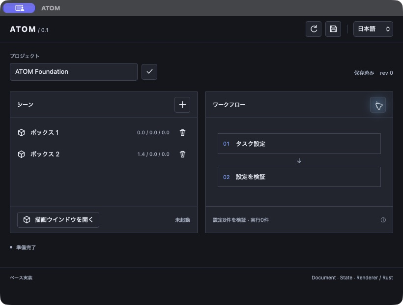
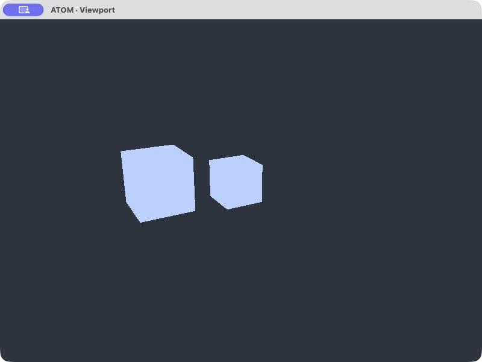

# ATOM foundation 0.1

2026-10-23（JST）。ローカル開発用のベース実装。現在は[同一ウインドウとドッキング](DOCKING.md)も実装済み。

## 現在できること

- Tauri 2の操作パネルを起動し、英語・日本語・简体中文を切り替える。
- Rust側で所有するプロジェクトの名前変更、ボックス追加・削除を行う。
- JSONファイルに保存し、再読込する。古いrevisionの編集を拒否する。
- 別プロセスが同じプロジェクトを開く場合、協調ロックで書き込み競合を防ぐ。
- 外部で保存ファイルが変更されていたら、上書き保存を拒否する。
- UNGEでReachのタスク設定8件を生成・検証する。結果の実行episode数は0。
- ThreeX／wgpuでRust所有のSceneを操作パネルと同じウインドウへ描画する。
- シーン／ワークフロー／3Dをタブ化・縦横の入れ子分割・フローティングし、閉じる操作で戻す。
- タブグループ全体を浮動化・復帰し、ウインドウ位置・サイズ・選択を再起動後に復元する。
- Rust共有のカメラを回転・パン・ズームし、一覧／3Dで選択した箱へフォーカスする。
- 選択輪郭、XZグリッドと座標軸を表示し、グリッド／軸を個別に切り替える。温かいニュートラル材質・照明を使用する。
- 面法線に基づく方向光・環境光と見下ろすカメラで、ボックスの立体感を表示する。
- 操作パネルの閉じる操作では、未保存の確定編集があれば終了を止める。

全ウインドウが一つのRust AppCoreを参照する。WebViewへ渡すのは最大256個の小さな物体記述と状態のみ。
画像、動画、GPUバッファ、モデル重みをJSへ渡す経路はない。
CPU依存のプロジェクト・CLIと、Tauri／wgpuのデスクトップ層を分離している。

## 起動と検証

```sh
cd /Users/Shared/Program/Tauri/ATOM
cargo run --locked -p atom-desktop
cargo test --workspace --locked
cargo clippy --workspace --all-targets --locked -- -D warnings
cargo fmt -p atom-core -p atom-cli -p atom-desktop -- --check
node --check apps/desktop/ui/app.js
```

キャッシュ済みの環境では各Cargoコマンドに`--offline`を追加できる。
確認環境はmacOS arm64、Rust 1.99.1。Cargo.lockを含み、外部path依存はない。
HTML／CSS／JSをTauriに埋め込むため、起動にNode.jsビルドや開発HTTPサーバーは不要。
CLI・Desktopともプロジェクトの親ディレクトリが存在する必要がある。

macOSでは`python3 scripts/build-dev-app.py`で`target/debug/ATOM.app`を生成できる。
ローカル開発用の未署名bundleであり、配布用パッケージではない。

```sh
cargo run --locked -p atom-cli -- init /tmp/atom-example.atom.json "My Lab"
cargo run --locked -p atom-cli -- inspect /tmp/atom-example.atom.json
cargo run --locked -p atom-cli -- validate /tmp/atom-example.atom.json
```

同じファイルをDesktopで開いている間はCLIにもロックエラーが返る。
`.lock`ファイル自体は残るが、ロックはOSが管理する。ファイルの存在を使用中判定に使わない。
外部変更を検出する仕組みは非協調プロセスとの完全な排他を保証しない。
保存は一時ファイルのsync→rename→Unixのdirectory syncで行う。複数ファイルtransaction、Undo永続化は未実装。

## 実測した範囲

| 確認 | 結果 |
|---|---|
| 通常workspace test | 168 passed、0 failed、11 ignored（GPU5件とbenchmark6件） |
| GPU追加試験 | `cargo test -p threex-renderer gpu -- --ignored`：5 passed |
| Clippy | workspace／all-targets、警告をエラーとして成功 |
| Desktop／CLI build | 成功 |
| コピーしたソースのhash | 元のimport hash、ATOM拡張のoverride hashと照合 |
| CLI | init、validateで2ノード完了・タスク設定8件・episode 0件 |
| macOSネイティブ操作 | 追加、名前変更、保存、再読込、設定検証、三言語切り替え |
| macOS GPU表示 | 同一Windowで3Dと2つの子パネルを表示。浮動側から編集し、再ドッキングして状態が一致することを確認 |
| ブラウザー単独表示 | レイアウト表示とDesktop必須表示。Rust APIのmock成功は表示しない |

wgpu経由の依存`block 0.1.6`には将来のRust互換性警告がある。今回のbuild／test失敗ではない。
通常testがskipするGPU試験は、GUIセッションのGPUにアクセス可能な実行環境で別途実行した。
この結果はWindows／Linux、他GPU、長時間稼働、全Surfaceライフサイクルの認定ではない。

初期ベース時点の表示記録（現在の構成・検証は[DOCKING.md](DOCKING.md)）：





## 未実装・制限

- MuJoCo、ロボットの関節／接触、センサー、物理step。
- vLLM-apple／Strata接続、モデルdownload、LoRA、学習Worker、実験ジョブ管理。
- 自由なノード編集。現在は登録済みの固定2ノードで設定検証を行う。
- GPU Graphとの合成、パネル複製、浮動グループ内の分割。
- 任意mesh、テクスチャ、学習用RGB／depth出力。カメラ操作と単一選択・フォーカスは実装済み。
- 編集時の派生Sceneは全再構築。ThreeXの差分更新への最適化は後続。
- 最小幅240pxのWindow実表示検証。1024×621へのOS配置・再起動復元と380×560の3D表示は確認済み。
- 署名・notarization、Windows／Linux、複数ディスプレイ、最小化復帰はPending。

## ソース配置

| パス | 内容 |
|---|---|
| `crates/atom-core` | Project、AppCore、保存、UNGE Registry、ThreeX Scene変換 |
| `crates/atom-cli` | GUI不要の初期化・検査・設定検証 |
| `apps/desktop` | Tauriホスト、native viewport、静的操作UI |
| `vendor/threex` | コピーしたcore／renderer |
| `vendor/unge` | コピーしたcore／executor、ライセンス、参照資料 |
| `vendor/manifest.json` | コピー元・HEAD・未コミット状態・ファイルhash |

English: The foundation includes a native desktop shell, Rust-owned project editing and persistence,
UNGE task-spec validation, and an embedded ThreeX/wgpu viewport with tabbed, split and floating Scene, Workflow and 3D panels. Physics, LLM inference, training,
and graph editing remain future work. Tab groups can float together; native window geometry persists, and lighting reveals object faces. The local validation passed 168 normal and five GPU tests.

简体中文：基础版包括原生桌面界面、Rust持有的项目编辑与保存、UNGE任务配置验证、嵌入式ThreeX/wgpu视图，以及支持标签、分割和浮动的场景、工作流与3D面板。
物理仿真、LLM推理、训练和节点编辑尚未实现。已支持整组浮动、原生窗口位置与尺寸恢复，以及物体光照。本机验证通过168项普通测试及5项GPU测试。
