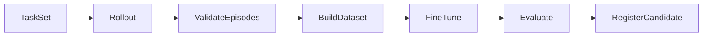

# ThreeX / UNGEを活用する設計

確認日：2026-10-23（JST）。ローカルソースと資料の静的確認に基づく。
この文書は採用方針を示すもので、ATOMへの組み込み・build・GPU試験は未実施。
元リポジトリは変更していない。

## 1. 調査対象と再現性

| 対象 | HEAD | 調査時の状態 |
|---|---|---|
| `/Users/Shared/Program/Tauri/ThreeX` | `d87193037fb9ce20d474973e4ad946ca95ede8ad` | rendererやdocsに未コミット変更あり |
| `/Users/littlebuddha/Desktop/alias/UNGE` | `5498d1bf371bb13e2d6e17174531f70a7fd97c9e` | lockfile、文字描画、依存設定、docsに未コミット変更あり |

HEADだけでは閲覧した状態を再現できない。主な確認ファイルのSHA-256を
[reference-snapshot.json](reference-snapshot.json)に保存した。これは全ソースの完全なsnapshotではない。
実装への取り込み時には採用commitまたはソース全体の不変snapshotを別途固定する。

## 2. 採用する役割

| 機能 | 利用方針 | 現在確認できた境界 |
|---|---|---|
| 3D Scene | ThreeX coreを描画用の派生Sceneとして利用候補にする | SoA、階層変換、差分instance更新がある |
| 3D描画 | ThreeX rendererをプリミティブによる初期表示に利用 | Box／Plane／Sphere。任意mesh、UV、texture、PBRは不足 |
| GPU lifecycle | ThreeXの世代付きSurface、最新要求保持、有界復旧を参考にする | 実OS／GPU表示は資料上もPending |
| ノード編集 | UNGE core／interaction／renderをワークフロー編集へ利用 | Command、Undo、型付きPort、Rust所有のView、GPU文字描画 |
| 実験の段階実行 | UNGE executorのRegistry／NodeExecutorを使用候補にする | 階層単位の非同期DAG。周期実行・Streamingは未実装 |
| パネル配置 | UNGEのmacOSサンプルを取り込みの基準にする | 1つの設定WebViewのボタン切り離し・再結合・配置保存 |
| 原子的な保存 | ThreeXのjournal／receipt設計を参考にする | ThreeX文書専用。ATOM全体の保存をそのまま代替しない |

UNGEのmacOS合成・操作・GPU試験は既存資料で報告されている。今回その結果を再測定していない。
ThreeXのREADMEには古い「ホスト未接続」という説明と後続の接続完了記述が併存するため、
native-renderer／native-redraw資料と実装を照合した。接続コードの存在と実機検証済みは区別する。

## 3. ATOMの正本を分裂させない

`AtomProjectService`がproject manifest、シーン定義、タスク、実験、サブ文書参照を管理する。
UNGEのグラフは専用Engineが唯一の可変所有者となり、AtomProjectServiceはEngineのhandleを保持する。
UNGE WorkspaceとEngineに同じDocumentの可変コピーを持たせない。
ワークフローの実行時snapshotはRustで取得し、graph revisionとhashをRunManifestへ固定する。

ThreeXのSceneは描画用の派生データとしてRenderServiceが所有する。
物理の正本はMuJoCo SimulationRunner、編集の正本はAtomProjectServiceに置く。
物理tickごとの姿勢更新をThreeXの永続Document／Undo／fsyncへ流さない。
ThreeXのdirty rangesとscene stampで表示を更新し、停止中はon-demand redrawにする。
実行中はsimulation snapshotの更新で描画を起こし、全tickの描画を要求しない。

ThreeXのpacked instance indexは永続IDではない。`robot/link/geom ID → ThreeX entity ID`の対応をRustで管理する。
MuJoCoのworld姿勢を使う場合は二重に親変換を適用しない。
ThreeXのXYZ Euler radiansと物理のquaternionの変換を検証し、形状の寸法を関節階層のscaleへ混入させない。
初期はlinkとvisual子ノードを分けるか、world姿勢を持つ独立geomとして表示する。
任意matrix／quaternion入力への拡張は後続候補とし、既存wire対応済みとは扱わない。

複数文書の保存は「同じtransactionで保存された」という保証を現APIから推定しない。
初期は内容hash付きのgraph・scene設定を不変ファイルへ保存し、全ファイル確定後にproject manifestを原子的に交換する。
実行中の編集は次のrunへ適用し、実行中snapshotを変更しない。

## 4. 一つのGPU合成層

両方の依存指定はwgpu 27.0.1。ATOMの最初の互換性候補も27.0.1とし、
前回調査で見つかったwgpu 30系への更新を同時に行わない。
ただし依存の一致だけでDevice／Texture／Surfaceの共有が動作すると判定しない。

コード上、ThreeXの`Renderer::render`とUNGEの`GpuRenderer::render_in_region`はcolor attachmentをclearする。
同じSurfaceへ順番に呼ぶだけでは先の描画を消す。ATOMは次の合成方式を候補にする。

1. RenderServiceがDevice／Queueとウインドウ別Surfaceの唯一の管理者になる。
2. ThreeXの3D表示とUNGEのノード表示をそれぞれのoffscreen TextureViewへ描く。
3. 同じDevice上のtextureをATOMのwgpu compositorでパネル領域へ配置してpresentする。
4. WebViewは設定・ツールバーなどの領域に置き、描画面のraw pixelsを受け取らない。

ThreeXはDevice／Queueを受け取るconstructor、UNGEは外部Device／Queue／TextureViewを使う低水準APIを持つ。
高水準SurfaceRendererを両方そのまま起動する構成は避け、device注入・format・色空間・resize・解放順をスパイクで検証する。
これは未実装の統合層である。offscreen分のGPUメモリーと合成時間を予算へ加える。
初期は3D／Graphをタブで切り替え、非表示パネルは描画を休止できるようにする。

ThreeXのunlit表示はデバッグ用に使えるが、RGB／depth／segmentationの学習センサーには別の出力契約が必要。
MuJoCoのcapsule／cylinder／meshをBoxで代用して表示する場合も、物理形状は変えない。
見た目の代用を学習用カメラの正確な出力として採用しない。

## 5. ドッキングの実装経路を具体化

UNGEの`examples/tauri-host/src/workspace.rs`では、同じWebViewを`reparent`し、
移動中を排他制御し、PointerをCancelして、配置と入力領域を再計算している。
label認可・下書き保持・失敗時の復帰・通常配置の保存をATOMでも維持する。

macOS初期スパイクではUNGEと同じTauri unstable APIを、ホストのWindowComposition adapter内だけで利用する。
前設計の「unstable APIを必須前提にしない」という方針は、この局所的な採用候補へ変更する。
core／物理／学習にはこの依存を伝播させない。

1パネルのボタン操作が動いても、Adobe形式の任意ドラッグドッキングが完成したことにはならない。
ATOMではDockTreeのSplit／Tabs／Panel、drop zone、複数WebViewの認可、再結合、配置復旧を追加する。
UNGEのサンプルは`controls`等の固定labelと1つのpanelを前提にするので、そのまま汎用DockManagerとして使わない。
OS移動失敗時には意図した配置と実際の親を照合し、不整合のまま表示成功にしない。

Tauri版はThreeX hostが`=2.12.1`、閲覧時のUNGEサンプルが`=2.12.4`、runtime-wryが`=2.12.2`。
この厳密指定を一つのアプリで共存できると仮定しない。
初期はThreeX core／rendererとUNGE core／executor／renderを選び、Tauri hostをATOMで一つにする。
UNGE側を基準候補に依存を解決し、Cargo.lockを固定してcompileとnative表示を確認する。
高水準ホスト同士の丸ごと結合は初期対象外。

## 6. UNGEで組む学習ワークフロー

各ノードはATOM側の信頼済み`NodeExecutor`としてRegistryへ登録する。
`Rollout`は一つのepisode集合のjobを開始・監視し、その内部をSimulationRunnerが固定刻みで進める。
物理の各tickをDAGの一巡や循環Edgeに変換しない。
標準のPython／Remote adapterはUNGEのLater項目なので、ATOMのWorkerClientで別途実装する。

画像・Tensor・dataset・checkpointは`Value::Resource { id, data_type }`として渡す。
内容hashと版を含む不変artifact IDをATOMのArtifactStoreで管理し、JSONに巨大配列を詰め込まない。
LLM呼出、rollout、学習、artifact登録は初期は`pure: false`とする。
固定入力・固定版で再現できる変換のみ、別途検証してcacheを有効にする。

UNGEのRunServiceは単一active runと有界な履歴・進捗を持つが、永続GPUジョブキューではない。
ATOM JobManagerがプロセス、メモリー、checkpoint、再開、retryの正本を持ち、
`graph_run_id / node_id / atom_job_id / attempt_id`でUNGEへ進捗を投影する。
Futureの破棄だけではPython／HTTP／GPU処理は停止しない。cancel→ack→timeout時の所有Worker終了まで管理する。
外部副作用はUndoで戻らない。ノード編集のUndoとジョブ停止・artifact履歴を分離する。

## 7. 取り込みと最初の検証

開発時は指定パスをpath依存候補として利用できるが、配布buildには固定revisionまたはsnapshotを用意する。
ソースの一括コピーや両repoの変更は今回実施していない。
UNGEにはMIT／Apache-2.0のLICENSEがある。ThreeXは確認範囲でLICENSEファイルが見つからず、配布時に条件を確認する。

最初の確認項目：

- 一つのlockfileで依存解決し、ThreeX／UNGEのCPU APIをATOMから呼べる。
- プリミティブの3D表示と小さなノードグラフをoffscreen合成し、clearで互いを消さない。
- 2ウインドウの編集競合、label認可、DPI・領域入力、再parentを確認する。
- MuJoCoの姿勢をThreeXへ反映しても、Document履歴や保存queueがtickごとに増えない。
- UNGEのノードからmock Workerを呼び、進捗・失敗・二重登録防止・キャンセルを確認する。
- 次に実際のLLM／MuJoCo／MLX Workerへ置き換える。

## 8. 主なコード根拠

- [ThreeX Scene](/Users/Shared/Program/Tauri/ThreeX/crates/core/src/lib.rs)
- [ThreeX Renderer](/Users/Shared/Program/Tauri/ThreeX/crates/renderer/src/lib.rs)
- [ThreeX native Surface](/Users/Shared/Program/Tauri/ThreeX/crates/tauri-host/src/surface.rs)
- [ThreeX native描画の検証範囲](/Users/Shared/Program/Tauri/ThreeX/docs/four/native-renderer.md)
- [UNGE取り込み契約](/Users/littlebuddha/Desktop/alias/UNGE/docs/AI_INTEGRATION.md)
- [UNGEパネル移動実装](/Users/littlebuddha/Desktop/alias/UNGE/examples/tauri-host/src/workspace.rs)
- [UNGE GPU描画](/Users/littlebuddha/Desktop/alias/UNGE/crates/unge-render/src/gpu.rs)
- [UNGE RunService](/Users/littlebuddha/Desktop/alias/UNGE/crates/unge-executor/src/service.rs)
- [UNGE未実装項目](/Users/littlebuddha/Desktop/alias/UNGE/docs/ROADMAP.md)
