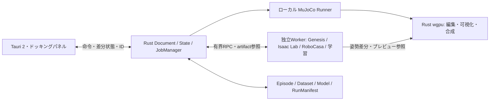
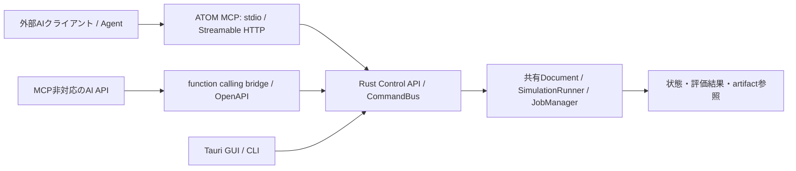

# ATOM Roadmap

更新：2026-10-23（JST）。ベース実装済み。詳細は[FOUNDATION.md](FOUNDATION.md)。

状態の意味：

- 🟢 [Done] implemented in the current codebase。実装にのみ使用する。設計文書の作成を機能実装と数えない。
- 🟠 [Next] high-priority unfinished work。直近の実装列。
- 🔴 [Later] planned, but not the closest next step。前段の成立後に行う。
- ⭕️ [Pending] Anything that can't be tested in the dev environment is on hold for now。必要環境がない検証。

今回の成果物はTauriアプリ、Rustコア、CLI、コピーした依存ソース、テストと設計・検証文書。
ThreeX／UNGEの採用ソースはhashとコピー元revisionを記録した。
参考repoのDoneはATOMのDoneへ転記しない。
## 効果に基づく実装順（2026-10-23）

- 🟢 [Done] 位置IK：既存のFK・関節制限・保存・Undoを使い、選択部位の中心をXYZ目標へ移動する。人型・双腕に対応。Reach／把持の前段となる姿勢生成を先に実装。
- 🟢 [Done] M1のReach v1：無重力・選択双腕のみのprofileで、固定seedのreset／継続step、参照サーボ制御、成功／timeoutと実物理の時系列記録を実装。任意scene・重力負荷でのReachは別段階。
- 🟢 [Done] Reach Episodeのmanifest内包・原子的保存、記録姿勢の再生／seek／pause、CLIで再実行・フレーム取得・記録比較。PlanTrace・solver stateからの分岐は未実装。
- 🟠 [Next] ローカルControl APIの読み取り／dry-runと接続診断、vLLM-apple／Strataの能力照会・短い推論。共有Rust文書と予算付き実行へ接続する。
- 🔴 [Later] 位置IKの3D目標ハンドル・ライブプレビュー、向きの制約、衝突・バランスを考慮する姿勢計画。素材表示・操作補助の拡張と並行し、依存が成立した項目から着手。

## 再現可能なReach／Episode v1（2026-10-23）

- 🟢 [Done] `atom-reach-dual-arm-zero-g-v1/splitmix64-v1`：選択した双腕だけを取り出す無重力課題。素材・床・編集済み関節姿勢を保持し、他物体は除外。元Documentの物理設定・dirty・履歴は変更しない。seedから参照関節目標とFKの目標中心を決定し、緑のrenderer専用マーカーで表示。
- 🟢 [Done] 永続MuJoCo Workerのreset／step。resetでauthored qpos・ゼロqvel・ctrl・solver stateを初期化し、stepは同じ`MjData`を0.002秒×10進める。指令は安定object ID／axis／qpos index付きのrad位置目標。不正指令は物理も記録も進めない。
- 🟢 [Done] 3.5cm以内のpost-action観測が5回連続で成功。上限1〜500 control stepでtimeout、同tickなら成功を優先。終了後のstepを拒否し、Workerをkill／wait。runのwall budget 15秒＋進行中stepの最大3秒、startup最大15秒。途中エラーは最後の有効な部分記録を保持し、再実行にはresetを要求する。
- 🟢 [Done] Episode schema v1に初期scene、seed/profile、source hash／GUI revision、MJCF hash、指令channelとqpos／qvel index、参照制御値、刻み・判定規則を内包。全frameにsim time・qpos／qvel・手先／物体姿勢・距離・outcome・実engine／Python／OS情報を記録。actionは前frameから観測時刻までの区間へ対応し、reset frameだけNone。
- 🟢 [Done] 64MiB制限、checksum、manifestの再構築・model hash・初期姿勢・時刻・指令制限・連続成功／終了判定の検証。syncしたtempからno-clobberで公開し、既存別内容の上書き、途中ファイル・改変・不整合を拒否。Running checkpointは正常な部分記録として区別し、完了と数えない。
- 🟢 [Done] Workflowにreset／single-step／終端までrun／保存／終了、記録一覧の読込、seek／play／pauseを三言語で追加。Rustがepisode・cursor・再生世代tokenを所有。古い再生loop・古いrun ID・重複stepを拒否し、全windowへ同じsnapshotを通知。ロード済み記録は読み取り専用でMuJoCo不要。元文書にないIDの選択・フォーカスと、表示中sceneのmesh metadataにも対応。
- 🟢 [Done] CLIの`reach-run`／`episode-replay`／`episode-compare`。一意episode IDを比較対象から外し、manifest・全frameの完全一致を確認。seed 0〜9を各2回、MuJoCo 3.1.6で同じ遷移と10種すべての成功を確認。seed 7は24step／0.48秒で成功、上限1stepはtimeout。学習済み方策の成績や環境間の物理等価性と扱わない。
- 🟢 [Done] Worker強制終了後の部分記録保持、終了後process停止、原子的保存・再読込、stale／重複要求、共有再生・元scene復帰を検証。Metalで記録の最終姿勢への描画変化と先頭seekの同一pixel復元を確認。実core＋MuJoCoのGUIで一連の操作と3言語・幅900／280／220px、コンソールエラーなしを検証。
- 🟠 [Next] Control API／MCP読み取り・dry-run、vLLM-apple／Strataの能力照会、Episode品質検査と学習用export。地球重力下でのサーボ／制御器の調整、任意scene・robotのReach、runtime doctor・非同期job停止も継続課題。
- 🔴 [Later] PlanTrace、solver snapshotからの再開・分岐、衝突回避目標、重力／外乱のrandomization、学習方策比較、LeRobot等へのexport。現在の参照joint目標は教師側情報を使うため、学習方策の入力にそのまま混ぜない。
- ⭕️ [Pending] native Tauri IPC・OSイベント配送・実window再生scheduler、浮動／複数モニター／他OSでの手動QA、異なるMuJoCo／Python／CPUでの再実行比較。GUIはHTTP host経由の実core、Metal試験はoffscreen。seedだけで環境を跨ぐbit一致を保証しない。

## 位置IK（2026-10-23）

- 🟢 [Done] 関節選択の下に折りたたみ式の位置IKを追加。固定する祖先の選択、Y-upワールド座標のXYZ目標（m）、現在位置の取得、適用アイコン／Enter、未確定入力のEsc復元。英語／日本語／简体中文に対応し、説明はⓘへ集約。
- 🟢 [Done] `SolveIk { id, base, target }`を共有Rust Commandへ追加。選択部位の中心に対する位置IKを、基点の直下から選択部位までの関節だけで求める。基点と祖先の角度は保持し、ほかの子孫は通常のFKで親へ追従する。
- 🟢 [Done] 関節制限付きCCD＋減衰付き最小二乗補正と改善時のみ受理するbacktracking。決定的な微小再開始、最大240 sweep／開始・全体6000のFK評価予算、1mmの位置許容誤差。失敗・不正入力・古いrevision・preview中は文書と履歴を変更しない。局所探索の非収束を幾何学的な到達不能の証明と扱わない。
- 🟢 [Done] 成功した全関節角を1件のUndo／Redoとして保存。到達済みの目標は無変更・履歴なし。Tauriのeditをblocking workerへ移し、計算をnative UIスレッドから分離。大容量データをWebViewへ送らない。
- 🟢 [Done] 双腕・人体・多軸・全身チェーン・一直線からの屈曲・回転済み基点・編集済み制限・決定性・保存復元・一括履歴・失敗時非変更をcoreで検証。実MuJoCoのauthored keyframeで手先位置と限界を照合し、1step／reset後の復元を確認。
- 🟢 [Done] Metal offscreenでIKによる実フレームの変化とUndo／Redoのピクセル復元。実Rust coreに接続したGUIで到達・基点保持・履歴・Esc・失敗・無変更・保存復元と3言語／幅900・280・220pxを検証。
- 🟢 [Done] Reach v1の参照制御・成功判定・Episode記録を別経路で実装。位置IK自体は静的姿勢編集で、Reach v1もIK計画・把持・姿勢安定方策ではない。
- 🔴 [Later] 3D目標ハンドル、向きの制約、関節支点・軸編集、自己衝突・環境接触・バランスの制約。人体の医学的可動性を保証しない。
- ⭕️ [Pending] 実Tauriウインドウのnative IPC・イベント配送、各OS・浮動／複数モニターでの手動QA。GUI試験はHTTPテストホスト＋実coreであり、native WebViewの実操作とは区別する。

## 実装済みのベース

- 🟢 [Done] ThreeX core／renderer、UNGE core／executorをATOM内へコピー。hashと元revisionを記録。
- 🟢 [Done] 単一workspaceとCargo.lock。Tauri 2.12.4／wgpu 27.0.1でbuildとClippyが成功。
- 🟢 [Done] Rustの共有Project／State、revision競合拒否、入力検証、ThreeXへの派生Scene。
- 🟢 [Done] JSON保存・再読込、プロセス間の協調ロック、外部変更検出、一時ファイルからの置換。
- 🟢 [Done] CLIのinit／inspect／validate、UNGEのTaskSet→Validateの実行。物理実行0件を明記。
- 🟢 [Done] 三言語Tauri操作パネル、ボックス追加・削除・名前変更・保存・再読込。
- 🟢 [Done] 別ウインドウのThreeX／wgpu描画。macOS実機で2個のボックスを表示。
- 🟢 [Done] 通常143テストと追加GPU2テスト、CLI・ネイティブUI操作の確認。

下記M0以降は完成形に向けた工程。ベースで完了した部分と追加作業を区別する。

## 同一ウインドウとパネル（2026-10-23）

- 🟢 [Done] 親WindowのThreeX／wgpu描画とtoolbar／scene／workflow／viewport子WebViewを合成。
- 🟢 [Done] Rustのタブ・分割ツリー、中央へのタブ結合、四辺への縦横分割、入れ子構成とタブ順変更。
- 🟢 [Done] 分割境界のライブ調整・矢印キー操作、キャンセル、配置競合拒否とリセット。
- 🟢 [Done] 全3パネルの個別フローティング。3Dも同じScene／Device／Rendererを維持してSurfaceを切り替える。
- 🟢 [Done] 同じWebViewをreparent／表示切り替えし、ワークフローの結果を保持。
- 🟢 [Done] 配置v3のツリー・選択・比率・浮動グループ・三言語を保存し、v1／v2を移行。
- 🟢 [Done] 通常175テスト、実GPU5テスト、ビルド、Clippy。macOSでタブ・分割・3D切り離しと共有Scene更新を確認。
- 🟢 [Done] ネイティブWindowの位置・サイズ保存、モニター作業領域／DPIに合わせた画面外復旧。macOSで再起動復元を確認。
- 🟢 [Done] タブグループ単位のフローティング・復帰・個別再分離。3Dを含むグループの選択・並び順を保持。
- 🟢 [Done] ThreeXコピーの面法線・方向光・補助光・環境光と見下ろすカメラ。実GPUで3面の陰影を確認。
- 🟢 [Done] Rust共有カメラのorbit／pan／zoom、一覧と3Dクリックによる選択、選択オブジェクトへのフォーカス、浮動・再ドッキング後の視点保持。
- 🟢 [Done] 深度を使った選択シルエット、ズーム追従XZグリッド、色分け座標軸と個別切替。材質・照明・背景・UIを温かいニュートラル色へ調整。
- 🟢 [Done] 選択オブジェクトの移動・回転・スケール、XYZ入力、軸ハンドル、ドラッグ単位のUndo／Redo。Rustの共有履歴128件・保存時点判定・中止を実装。
- 🟠 [Next] 変形のスナップ、回転リング／スケール専用ハンドル。
- 🔴 [Later] カメラの再起動復元、複数選択、全体フィット、ピンチ専用ジェスチャー。
- 🔴 [Later] パネル複製、浮動グループ内の分割、影の投影・PBR。
- ⭕️ [Pending] 複数モニターの実DPI移動、狭いウインドウと最小化復帰、他OSのネイティブ検証。

操作・制限・検証は[DOCKING.md](DOCKING.md)。

## Hugging Face／OpenUSD（2026-10-23）

- 🟢 [Done] SimReady Centralの公開資産に対応する入口を追加。Hugging Face datasetのpackage一覧・絞り込み、40桁commitへの固定、SimReady packaging v1の単一root USDを資産単位で取得。
- 🟢 [Done] manifest→BOMのSHA-256、各ファイルのサイズ・SHA-256を検証。元USD・payload・材質・texture・licenseをローカルキャッシュに保持し、出典・commit・license・変換時SDK版を保存。
- 🟢 [Done] 公式OpenUSD 26.8 SDKでUSD／USDA／USDCのreference・payload・通常instance、階層変換、Y／Z-upとmetersPerUnitを合成。フレーム0の静的Mesh／Cube、凹多角形・hole・反転変換を三角形メッシュへ変換。
- 🟢 [Done] RustのArc共有メッシュ→wgpuの頂点・index bufferへ直接配置。WebViewへ形状配列を転送せず、小さな資産summaryだけを通知。色はdisplayColor／材質のベース色とface subsetを反映。
- 🟢 [Done] 取り込み・削除・変形の保存／復元とUndo／Redo、schema v3（v1／v2移行）。メッシュは保存文書に含め、別環境の再表示にSDKや元ファイルの再取得を要求しない。
- 🟢 [Done] 共有文書の取り込み状態と中止操作。失敗・中止時の履歴非変更、子Worker終了、予算・revision・依存範囲の検証。元の単一massまたはSimReady metadata massを取得できた場合は保持。
- 🟢 [Done] MuJoCoへ実メッシュの凸包collisionを出力。メッシュのcompiler座標補正を戻して表示し、静的資産の姿勢が計算後にずれないことを検証。
- 🟠 [Next] texture／UV／normal／PBR・MDL表示、実メッシュに沿う選択輪郭・三角形ピッキング、source hierarchyを保った編集、USD物理材質・collision・jointの忠実なbackend変換。
- 🔴 [Later] USDZ、PointInstancer、アニメーション、subdivision評価、複数rootのpackage選択、中央検索サービスのsemantic search、USD差分の書き戻し。
- ⭕️ [Pending] macOSロック後のNative取り込み完了・保存・Undo／Redo／cancel操作の確認、private／gated datasets、全2,575資産の互換性、巨大scene、Isaac／RTX／PhysX固有機能。SimReady側のconformanceをATOMの再現保証と扱わない。

現在の取り込みは、見えている形状を一つの静的メッシュにまとめる。関節を含む資産も表示姿勢で固定し、関節制御の取り込みとは数えない。物理素材はATOMのカスタム既定値を割り当てる。接触は凸包近似で、テクスチャ・MDL・多物理の完全再現は未実装。対応外・近似は資産のⓘに三言語で表示する。

## 可動範囲の上下限編集（2026-10-23）

- 🟢 [Done] 各関節軸の下限／上限をGUIの度単位入力で編集。英語／日本語／简体中文に対応。−180°〜180°、下限＜上限をRustで検証し、逆転・同値・非有限値・不正な軸を拒否する。
- 🟢 [Done] 3Dの下限gripはシアンで内側、上限gripはマゼンタで外側に配置。±180°など同じ角度位置でも選び分け可能。円弧の角度操作より端点gripのヒットを優先し、操作中の端点を白く強調。描画とヒット判定は同じ`limit_handle`を使う。
- 🟢 [Done] `SetJointRange`が範囲と必要な現在角度補正を原子的に変更し、既存の保存／復元／Undo／Redoへ統合。範囲外になった角度は新しい端へ補正し、同じUndoで元の範囲と姿勢へ戻す。
- 🟢 [Done] typed joint preview（Angle／Lower／Upper）とowner／tokenを共用。端点ドラッグは反対側の限界を保持し、交差を表現可能な隣接f32値で防止する。プレビューは元文書から再評価し、拡張して元角度を再び含めれば姿勢も元角度へ復帰する。
- 🟢 [Done] Esc、フォーカス／viewport喪失、layout／DPI変更で範囲と姿勢を一緒に取消。1ドラッグの確定だけを1件の履歴とし、無変更操作は履歴を増やさない。数値入力はEnter／blurで確定、Escで未確定値を復元。
- 🟢 [Done] coreの保存・履歴・補正・不正入力・typed preview・stale token、native controllerの上下限・交差・full turn・極小区間を検証。Metal GPUで端点ドラッグ→円弧／姿勢更新→commit→Undo／Redo→取消を確認。MuJoCoへ変更後のrange／ctrlrangeと初期姿勢を出力し、実行・resetを検証。
- 🟢 [Done] 実Rust coreを使うGUI試験で数値範囲・姿勢補正のUndo／Redo、Esc、保存復元、編集後スライダーの制限、3言語・幅280／220pxを確認。
- 🟠 [Next] 位置IKの向き制約、自己衝突に配慮した可動範囲設定、軸・支点の編集。位置IKの基本実装は上記で完了。
- ⭕️ [Pending] Tauri実ウインドウでのOSイベント配送、複数モニター／フローティング／OS別の手動QA。UI操作試験はHTTPホスト＋実core、3D統合試験は同じnative controller＋Metal offscreen描画。

## 3Dガイドからの関節角度操作（2026-10-23）

- 🟢 [Done] 選択関節の円弧・現在角度の金色ray・短い回転軸を3D上で直接ドラッグ。GPUガイドと同じworld形状をヒット判定へ使い、分割領域のオフセットとDPIを反映。hoverはGrab、操作中はGrabbingカーソル。
- 🟢 [Done] 円弧はrayと回転平面の交差から相対角を求め、つかんだ位置への角度ジャンプを防ぐ。edge-onでは画面接線へ切り替え、軸のshaftは軸に直交する画面方向へドラッグ。±πをまたぐ動き、上限／下限と逆方向への即時切り返しに対応。
- 🟢 [Done] native-joint owner＋tokenで既存のpreview／commit／cancelを共用。途中は文書・履歴を変更せず、mouseup時に最終ポインター値をflushして1件だけ記録。無変更クリックは履歴を増やさない。
- 🟢 [Done] Esc、native Undo、ビュー外・window focus喪失、resize／DPI変更、layout変更で取消。古いドラッグは別ownerの新しい操作を変更しない。Shift＋左パン／Alt＋左orbitはハンドルより優先し、通常の形状操作はガイド以外で継続する。
- 🟢 [Done] 円弧／shaft、横向き、Retina、座標オフセット、near clip、角度制限、no-op、取消、stale token、親姿勢付きの複数軸を自動テスト。Metal GPUで直接ドラッグ→FK→実フレーム更新→commit→Undo／Redo→取消を確認。
- 🟠 [Next] 向き・自己衝突を考慮した姿勢作成。位置IKは実装済み。
- ⭕️ [Pending] 実Tauriウインドウ上でのOSイベント配送とポインター境界、フローティング／複数モニター／OS別の手動QA。現段階の直接操作試験は同じnativeドラッグcontrollerと実core・Metal offscreen描画を使用。

## 関節のライブプレビュー・3D可動範囲（2026-10-23）

- 🟢 [Done] `joint_command`のbegin／preview／commit／cancelをRustに実装。owner＋一意token＋project/revisionで1操作を保護し、ドラッグ途中は保存文書・dirty・履歴を変更しない。確定時の`SetJointAngle`だけを1件のUndoとして記録。無変更確定・取消では履歴を増やさない。
- 🟢 [Done] GUIのマウス・タッチのpointer操作とキーボード操作を連続反映。RPCは常時最大1件で、途中の入力を最新値へ集約。マウスを離す前に子孫リンクを含むFKが更新され、wgpuのSceneへ反映される。
- 🟢 [Done] Esc、pointercancel、capture喪失、window blurで全体を復元。別パネルからの編集・保存・物理・importをpreview中は拒否。古いtokenや別ownerの確定／取消は受け付けない。
- 🟢 [Done] 選択した関節の支点・軸・可動範囲円弧・端点キャップ・現在角度の金色rayをRust/wgpuで描画。親関節と先行する回転軸の姿勢を反映し、操作軸を強調。三軸の線分は最大315本で、WebViewへメッシュやフレームを転送しない。物理preview中は不正確な軸を表示しないよう非表示。
- 🟢 [Done] 連続プレビュー30回→1履歴、取消・no-op・競合・ABA token・関節フレームをテスト。実Rust coreへのGUI試験で押下中の姿勢変化、入力集約、Undo／Redo、Esc／pointercancel／blur、キーボード、保存復元、三言語と幅280／220pxを確認。
- 🟢 [Done] Metal GPUで円弧の実ピクセル・現在角度の変化・近クリップ・分割領域のクリップを検証。人体全体のFK Sceneと同じアプリ側変換から描画し、確定前に人体形状とガイドのフレームが変わることを確認。
- 🟠 [Next] 向き・接触・自己衝突を考慮した姿勢作成。位置IKは実装済み。
- ⭕️ [Pending] Tauriの実ウインドウをまたぐpointer capture、ネイティブIPC、各OS／入力デバイスでの手動操作QA。現段階のUI試験はローカルHTTPホスト＋実core、GPU試験はMetalのoffscreen描画。

ガイドは角度の範囲を示す操作補助で、到達可能領域や衝突しない姿勢を保証しない。形状越しに見えるoverlayとし、視認性に応じた表示半径を使う。色は関節のローカルX／Y／Zに対応し、世界軸の向きとは区別する。

## 関節角度のGUI編集（2026-10-23）

- 🟢 [Done] 人型182軸、旧簡略人型、双腕の各関節角に対応。度単位のスライダー・数値入力、関節プルダウン、軸ごとのリセットを英語／日本語／简体中文で提供。スライダーを離す／Enter／数値欄のblurで1編集を確定し、Escで未確定値を戻す。
- 🟢 [Done] `SetJointAngle`共通Commandが角度をラジアンで保持。軸数・有限値・上下限・root編集・revisionを検証し、不正入力は状態と履歴を変更しない。旧文書の省略された角度は0として読む。
- 🟢 [Done] Rustの順運動学から描画・選択・フォーカス用のworld姿勢を導出。rest形状と支点は保持し、角度変更で子孫リンクが追従。world座標の形状編集は逆変換してrest文書へ保存する。
- 🟢 [Done] 角度の保存・再読込、共通Undo／Redo、物理実行中の編集ロック。非ゼロ姿勢のMJCFには`authored` keyframe（qpos＋ctrl）を含め、ATOMのWorkerが起動時に適用。外部MuJoCoでの利用時は同keyframeを選ぶ。
- 🟢 [Done] 182軸の上下限／不正値、保存復元・履歴・競合・形状変形併用をテスト。MuJoCo 3.1.6で全リンクのFKとqpos／ctrlを照合し、物理結果の二重変換を防止。実Rust coreへ接続したPlaywrightで編集・保存・履歴・3言語・幅280／220pxを検証。
- ⭕️ [Pending] ネイティブTauri WebView／wgpuの統合操作QAと別OSでの確認。今回のGUI操作試験はローカルHTTP接続による実core検証で、ネイティブTauri IPCそのものは通していない。

## 人体の詳細関節モデル（2026-10-23）

- 🟢 [Done] 人型テンプレートを99リンク・98可動接続・182回転自由度へ拡張。浮動ベース6自由度は別計上。頸椎7・胸椎12・腰椎5、頭頸部、顎、左右の肩帯・肩・肘／前腕・手首、股・膝・足関節／距骨下関節、左右各5本の手指・足趾を持つ。
- 🟢 [Done] 同じ接続点に最大3つの直交回転軸と軸別制限を保持し、各軸をMuJoCoのhingeと出力制限付きサーボへ変換。手指・足趾・顎には小さいサーボ出力を使う。
- 🟢 [Done] 選択部位の回転軸・角度範囲と一体の可動接続数／回転自由度を3言語で表示。詳細モデルの追加・削除・保存・Undo／Redo、旧14関節モデルの無変更読込を検証。
- 🟢 [Done] MuJoCo 3.1.6で182軸の駆動方向・独立した運動学、末端軸の動作、1,000stepの物理実行を確認。Web UIはIPC shimで英語／日本語／简体中文、幅280／220pxの表示を確認。
- 🟢 [Done] 全回転軸の角度をGUIのスライダー／数値入力で編集。関節選択・軸リセット、軸別制限のRust検証、子孫リンクのFK追従、保存・復元・Undo／Redo、MJCF authored keyframeと物理プレビュー初期姿勢を実装。
- 🟠 [Next] 関節階層ツリー、向き・接触を考慮したIK、関節支点を伴う一体変形。関節限界の3D直接編集、位置IK、ドラッグ中の連続姿勢プレビューと角度円弧は実装済み。
- 🔴 [Later] 肩甲骨の滑走、橈尺関節・膝蓋骨・左右の顎関節、胸郭・肋骨・骨盤・靱帯・腱・筋骨格の詳細化と計測データによる校正。
- ⭕️ [Pending] 詳細モデルのネイティブ3D外観・パネル操作の実機QA、医学的精度・実機人体動作との照合。

「98」はこの工学モデルの親子接続数、「182」は回転軸数であり、人間の医学的な総関節数を表さない。固定結合や軟骨性結合を含む総数の再現、個体差、筋肉や軟部組織は未対応。肩帯・前腕・顎等は複数の解剖学的構造をまとめた近似。形状は温かい中立色の箱リンクで、写実的な人体メッシュではない。既存文書の簡略人型は自動置換せず、新たに人型テンプレートを追加して使う。

## 重力・物理素材・ロボットテンプレート（2026-10-23）

- 🟢 [Done] 地球・月・火星・無重力＋XYZ数値の重力設定。Rustで物理Z-upと編集Y-upを変換。
- 🟢 [Done] 8種の物理素材preset＋カスタム密度・滑り／ねじり／転がり摩擦。床にも素材を設定し、床接触は摩擦の幾何平均で解決。見た目の色とは独立。
- 🟢 [Done] 共通Command・revision・128件のUndo／Redo、schema v2保存・復元とv1読込時の移行。数値の範囲と有限性を検証。
- 🟢 [Done] 人型99リンク・98可動接続・182回転自由度（浮動ベースは別途6自由度）／双腕13リンク・各腕6関節。関節範囲・出力制限付き位置サーボ、追加・ルート削除・全体フォーカス、保存済みJSONとMJCFを提供。
- 🟢 [Done] Rustが管理するMuJoCo headless Worker。固定0.002秒刻みで最大1000step、15秒の実行上限、最終姿勢をwgpuへ反映。previewは文書・履歴へ焼き込まずresetで戻す。
- 🟢 [Done] MuJoCo 3.1.6で落下・ゼロg・任意方向・摩擦・密度／慣性・両テンプレートを実行。ネイティブUIで保存復元とUndo／Redoを確認。
- 🟠 [Next] 一般sceneの連続物理／pause、関節支点編集、把持・人型の姿勢安定方策。Reach v1はsingle-step継続・時系列記録・記録再生を実装済み。従来の汎用物理previewは編集状態からの短時間計算と最終姿勢表示。
- 🟠 [Next] 物体同士の接触ペアoverride、presetの校正・出典管理、明示質量／慣性、一般MJCF import。現在の密度由来の箱モデルから拡張。
- 🔴 [Later] 液体・浮力・MCP・各社AIの接続は下記計画を継続。
- ⭕️ [Pending] MuJoCo未導入環境・別OSでの配布と実行、実ロボット固有モデル・実機精度の検証。

## 統合ロボット学習環境への拡張設計

2026-10-23の公式資料再調査に基づく追加設計。以下の外部連携はすべて未実装であり、現在の175件の通常テスト・5件のGPUテストはシミュレーター連携の検証には含めない。
目標は、ロボット・課題の作成から実行、失敗解析、データ生成、LLM／方策学習、未学習条件での評価までを同じプロジェクトで追跡できるツールにすること。「最強」は機能数や公称FPSで判断せず、再現性、成功率、失敗から改善までの時間、計算費用で評価する。

### 既存基盤の役割と採用判断

| 基盤 | 公式資料で確認した特徴 | ATOMでの役割・採用境界 |
|---|---|---|
| MuJoCo CPU | 対話的制御に適した低遅延の経路。MuJoCo Warpは多数環境の総スループットを狙う別経路。[MuJoCo Warp公式](https://mujoco.readthedocs.io/en/latest/mjwarp/) | 最初の物理基準。Rustの専用Runnerから固定刻みで動かし、関節・接触・制御を検証。ATOMのwgpu表示を継続する |
| MJX／MuJoCo Warp | MJXにはJAXとWarpの実装があり、WarpはNVIDIA向け。MJX-Warpの自動微分対応は前提にできない。[MJX公式](https://mujoco.readthedocs.io/en/latest/mjx.html) | MuJoCo課題の並列学習候補。CPUモデルを無条件変換せず、対応する接触・拘束・センサーを検査する |
| Genesis World | Python APIに複数の物理ソルバー、センサー、並列環境を集約。Metalを含む実行経路を掲載。[概要](https://genesis-world.readthedocs.io/en/latest/user_guide/overview/what_is_genesis.html)、[導入](https://genesis-world.readthedocs.io/en/latest/user_guide/overview/installation.html) | 独立Workerで剛体の並列試験から開始。柔軟物・流体・触覚・微分可能な物理を段階追加。Macで全機能・公称性能が出るとは扱わない |
| Isaac Lab 3.0 | 正式版で物理・描画・可視化backendを分離し、Newton／OV Librariesによるkit-less経路を提供。Isaac Simは必要機能に応じた選択。[v3.0.0 release](https://github.com/isaac-sim/IsaacLab/releases/tag/v3.0.0) | 大規模RL／模倣学習のWorker。最初はLinux NVIDIAで検証し、Newton・PhysX・RTXなどを別能力として登録。Rust／wgpuへソルバーを移植しない |
| RoboCasa365 | 365課題、2,500以上のキッチン、3,200以上の物体を備える課題・データ・評価基盤。[公式概要](https://robocasa.ai/docs/build/html/introduction/overview.html) | 物理エンジンの一種として登録せず、RoboCasa／robosuite Worker上のTaskSuiteとして扱う。公式の制御・成功判定・評価経路を維持する |

Genesisの微分可能な物理には、接触経路・coupler・長い時間範囲でのメモリーや勾配の制限がある。機能単位で検証し、微分可能な物理とLLMの追加学習を混同しない。[公式制限](https://genesis-world.readthedocs.io/en/latest/user_guide/theory/differentiable_simulation.html)
RoboCasaはrobosuite依存と約10 GBのキッチンasset取得を案内している。採用時には双方のcommitとasset hashを固定し、必要量・保存先・ライセンスを示して選択取得する。[公式導入](https://robocasa.ai/docs/build/html/introduction/installation.html)

### ATOMが統一する契約

🟠 [Next] M0〜M1で最小の共通契約を作り、MuJoCo一つで成立を確認してからbackendを増やす。以下は設計上の型名で、実装済みAPIではない。

| 契約 | 責務・必須情報 |
|---|---|
| `RobotAsset` / `SceneSpec` | 元asset、hash、ライセンス、link／jointの安定ID、慣性、collision、駆動制限、センサー外部・内部パラメーター。元のMJCF／URDF／USDも保持する |
| `PhysicsSpec` / `GravitySpec` / `MediumSpec` | 重力presetと数値ベクトル、solver・時間刻み、媒質の密度・粘度・流速・領域、適用tick・解決済み設定hash |
| `PhysicalMaterial` / `ContactPair` | 見た目とは別の密度・質量・慣性・摩擦モデル、素材ペアの条件・値・backend変換、preset版と出典 |
| `Control API` / `atom-mcp` | GUI／CLI／外部AI共通の型付き命令・能力照会・非同期job、revision／権限／資源上限。MCPとfunction callingの入口 |
| `TaskSpec` / `TaskSuiteAdapter` | 課題ID・版、言語指示、reset分布、成功判定、失敗・timeout、観測／action schema、split、公式評価用profile。RoboCasa固有のロジックはadapter内で実行 |
| `SimulationBackend` | `probe / compile / reset / step_batch / snapshot / restore / stop`。対応する操作だけ公開し、非対応は理由付きで拒否。1環境もbatchの一種として扱う |
| `SensorProvider` / `RenderProvider` | 物理stateとRGB／depth／segmentation／接触等の生成元、tick、校正、色空間・単位。編集用wgpu画像と学習用センサー画像を区別 |
| `PolicyAdapter` / `TrainerAdapter` | 入出力・正規化・action chunk・制御周期、学習環境、checkpoint、停止／再開。LLM Planner、低レベルcontroller、VLAを別の実行種別にする |
| `Episode` / `RunManifest` | project revision、asset／task／dataset／model hash、backend／driver／solver設定、seed、初期状態、時刻、action、終端理由、資源・費用、評価protocolと成果物の参照 |
| `BackendCapabilities` | OS／device／precision、剛体・柔軟体・センサー・微分・並列数・保存復元の対応。`unknown / reported / verified / unavailable`と検証日・試験artifactを保持する |

シミュレーション境界はSI単位・右手系Z-up・quaternion XYZWを基準案とする。現在のエディターはY-upなので、Rustの座標変換層で接続し、既存文書のEuler値を暗黙に読み替えない。joint順、原点、カメラ光軸、depth定義、絶対／差分action、グリッパー開閉方向を往復試験する。形式を読めても物理的に等価とは認定しない。変換できない慣性・材質・拘束などは一覧で示す。

Rustが文書・ジョブ・表示状態を所有し、外部Workerはそのジョブの実行状態を所有する。Python環境はbackendごとに分離する。大量のrollout tensor、動画、重みはWorker／Rust／GPU側に置き、WebViewには流さない。独立エンジンのDeviceをwgpuと共有できるとは仮定せず、初期は姿勢差分とasset参照で表示し、必要な映像は有界の圧縮転送→Rustでdecode・合成する。GPU共有はOS／APIごとの後続最適化とする。

表示用フレームの間引きと学習記録の欠落を区別する。物理・センサー・方策・言語計画は別周期にし、遅いLLM応答で物理tickを止めない。計画には対象state版と期限を付け、reset後の古い計画を拒否する。

### 実装順序と受け入れ条件

以下を既存M0〜M4の具体化・拡張として進める。最優先経路は **共通契約 → MuJoCo実行 → 記録・再現 → LLM学習の一巡**。RoboCasa小規模接続はデータ契約の実用性を確認する次段階に置き、全エンジン導入や大規模asset取得を最初の完成条件にしない。

| 段階・状態 | 実装するもの | 完了を判定する実験 |
|---|---|---|
| M0-A 🟠 [Next] | backend registry／doctor、version付きRPC、能力表、資源上限、asset registry | mock Workerのtimeout・クラッシュ・未対応機能・古い応答を扱える。probe成功と実際のstep成功を別に表示 |
| M1-A 🟠 [Next] | Reach v1のreset／step・参照controllerとIKはDone。残りはロボット階層、MJCF import、一般sceneの物理pause／中断 | 固定seedのReachをheadlessとUIで実行。関節制限、座標、時間刻みを確認し、停止時にWorkerが残らない。URDF／USDの全面対応は後段 |
| M1-B 🟠 [Next] | Reach recorder／再生と10 seed比較はDone。残りは失敗分類、solver snapshotからの再開・分岐 | 初期検証として10 seedを各2回実行。固定backendで許容誤差を判定し、記録再生と物理再実行を区別。中断artifactは未完了扱い、保存復元未対応backendではaction列の再実行へ明示的に切り替え |
| M2-A 🔴 [Later] | vLLM-apple／Strata接続、SkillPlan、LLM SFT／LoRA、教師候補の検証 | 既存[RuntimeGateway設計](RUNTIME-INTEGRATION.ja.md)に従い、手書き基準→LLM計画→追加学習モデルを固定holdoutで比較。推論runtimeのautotuneを重み学習と数えない |
| M2-B 🔴 [Later] | RoboCasa adapter、小規模task browser、公式demo再生、収集・注釈・データ変換 | 一つのatomic課題と一つのcomposite課題でreset／action／成功判定／再生を通す。元demo ID・action schema・時刻・splitを保持し、公式loader／evaluatorで照合 |
| M3-A 🔴 [Later] | テレオペ、介入記録、BC／ACT基準、VLA、階層方策 | 同一観測で手書きcontroller・模倣学習・VLAを比較。LLMはskillを選び、controller／方策が関節命令を担当。教師用正解stateや未来フレームの混入を試験 |
| M3-B 🔴 [Later] | データ工場：成功／失敗／介入の選別、軌道拡張、品質検査、LeRobot等へのexport | source lineage、重複除去、train／validation／test分離を検証。同一元demoからの拡張は同じsplitに固定し、増量後のholdout改善と費用を測る |
| M4-A 🔴 [Later] | Genesis WorkerとMJX／Warp Worker、共通TaskSpecの限定subset、ベンチマーク | 同一の小型アーム課題を1／小batch／大batchで測定。compile・warmup・physics・sensor・policyを分離し、VRAM・CPU転送・成功率を比較。対応外の課題を自動移植しない |
| M4-B 🔴 [Later] | Isaac Lab 3.0 Worker、並列RL／模倣学習、randomization・curriculum | 一つの公式課題で学習→checkpoint→評価→停止／再開を確認。physics／renderer／visualizerを別に固定し、Macの編集UIから遠隔監視できる |
| M5 🔴 [Later] | RoboCasaのmulti-task／foundation／lifelong評価、失敗からの再収集、実験比較 | 未学習の物体・配置・task compositionと既習課題の忘却を測定。公式protocolと独自研究を別集計し、同一データ量・予算・seed群で比較 |
| M6 🔴 [Later] | system identification、遅延／ノイズ／摩擦randomization、sim-to-sim、実機adapter | 保存済み実機ログで校正誤差を計測後、shadow mode→制限付き操作へ進む。機体・非常停止・速度／力上限が未定の間は実動作を保留 |
| M7 🔴 [Later] | 柔軟物・流体・触覚、微分可能な物理、複数ロボット・別embodiment | 剛体基準から独立した課題で、接触安定性・勾配検証・メモリー・センサー校正を通す。エンジンの機能掲載だけでDoneにしない |

### 重力・素材・摩擦・液体の設定

2026-10-23追加・実装後更新。重力と箱モデルの物理素材は上記の範囲で実装済み。以下には未実装の拡張要件も含む。液体・媒質モデル・外部AI制御は未実装。

🟢 [Done] **Environment Inspectorと重力設定**を実装。プリセットとXYZ数値を編集でき、MuJoCoへ適用する。🟠 [Next] 大きさ・方向の独立入力と地球標準g比の補助表示。仕様IDの`earth_standard / moon_surface / mars_surface / zero_gravity`に対し、保存・APIのenumは`earth / moon / mars / zero`を使用する。

| プリセットID | 日本語 / English / 简体中文 | 大きさ m/s² | シミュレーション基準座標Z-upでの既定ベクトル |
|---|---|---:|---|
| `earth_standard` | 地球（標準） / Earth (standard) / 地球（标准） | 9.80665 | `[0, 0, -9.80665]` |
| `moon_surface` | 月（代表値） / Moon (reference) / 月球（参考值） | 1.62 | `[0, 0, -1.62]` |
| `mars_surface` | 火星（代表値） / Mars (reference) / 火星（参考值） | 3.71 | `[0, 0, -3.71]` |
| `zero_gravity` | 無重力 / Zero gravity / 零重力 | 0 | `[0, 0, 0]` |
| `custom` | カスタム / Custom / 自定义 | 入力値 | 任意の有限XYZ値 |

地球は標準重力、月・火星は表面重力の代表近似値をプリセットに採用する。[NASA月資料](https://nssdc.gsfc.nasa.gov/planetary/factsheet/moonfact.html)、[NASA火星・地球比較](https://solarsystem.nasa.gov/mars-by-the-numbers/)。位置・高度で変わる重力場、軌道上の自由落下、潮汐力を再現するプリセットではない。後続の重力場モデルとは区別する。

数値を変更したら`custom`として扱い、元preset ID／版と解決後のベクトルを保存する。Y-upの既存エディターとの軸変換をRustで行い、ゼロベクトルを正規化しない。無重力でも質量・慣性・接触は残し、空気抵抗や水中抵抗を自動で無効化しない。重力presetと`MediumSpec`は独立させ、月の重力＋水なども選択可能にする。

🟢 [Done] **PhysicalMaterialとObject Inspector**：木材、鋼、アルミニウム、ゴム、樹脂、ガラス、コンクリート、氷のpresetとカスタム数値を実装。値は乾燥接触の初期例で、校正済みデータではない。🟠 [Next] 校正データ・試験条件・出典の管理、任意ContactPairの編集。以下のうち共有素材・静止／動摩擦の別指定・明示質量／慣性等は拡張要件。

| 項目 | 設定・保存する情報 |
|---|---|
| 見た目と物性 | `VisualMaterialRef`と`PhysicalMaterialRef`を分離。表示色・roughness等を変えても摩擦や密度が勝手に変わらない |
| 密度・質量・慣性 | 密度kg/m³、質量kg、重心、慣性tensor。`density_derived`または`explicit_mass_inertia`を選び、密度と質量を矛盾したまま二重指定しない |
| 摩擦 | 静止摩擦μs・動摩擦μk（無次元、対応backendのみ）、滑り・転がり・ねじりのモデル別値、乾燥／濡れ等の条件。μを0〜1に一律制限しない |
| 接触ペア | 素材A×素材Bのoverride、未指定時の組合せ規則、実際に解決された値とbackend上の値。見た目の材質共有とは別管理 |
| その他の物性 | 反発係数、接触剛性・減衰、弾性等はbackend対応に応じて追加し、非対応を有効値として表示しない |
| 共有と個別上書き | presetを版付き参照し、個別変更か共有素材全体の変更かを明示。Undo／Redo、保存復元、API編集、旧文書移行に対応 |

MuJoCoのgeom摩擦はsliding／torsional／rollingの3値であり、そのまま静止／動摩擦の2値と同一視できない。adapterはモデル・単位・組合せ規則を持ち、異なる指定を黙って一つの値へ潰さず、非対応または選択された近似を返す。[MuJoCo XML reference](https://mujoco.readthedocs.io/en/stable/XMLreference.html#body-geom-friction)
物体をスケール変更した場合、密度由来なら体積・質量・慣性を再計算し、明示質量ならその保持方針と慣性更新を検証する。閉じていないmeshや中空形状の体積を外接boxで無断推定しない。床・ロボットのcollision形状にも素材を割り当てる。

🔴 [Later] **水中・液体環境は二段階で追加する。** 媒質の見た目だけを変えたものを流体シミュレーションとして扱わない。

| 段階 | 予定する挙動と設定 | 採用・完了条件 |
|---|---|---|
| M3-C：水中の剛体運動 | 真空・空気・淡水・海水・油系・カスタム媒質。密度kg/m³、粘度Pa·s、基準温度、流速m/s、領域・水面・水深。浮力、抗力、粘性抵抗、浮心と部分浸水を扱う | 単純形状から開始。沈む／浮く／中性浮力、静水中・一様流で検証。MuJoCoの流体力モデルを使う場合、浮力と有限水域を別途実装・検証し、同じ力を二重計上しない |
| M7-A：液体自体の運動 | 注ぐ、こぼれる、攪拌、水面変形、容器との相互作用。SPH／MPM等の対応solver、粒子／格子解像度、substep、境界条件。表面張力・濡れ・複数流体は対応を個別確認 | Genesis等の独立Workerで剛体と液体の双方向連成を検証。液体量・密度誤差、容器からの漏れ、時間刻み／解像度への収束、計算資源を記録 |

MuJoCoの流体モデルは周囲の流体状態を持たない近似で、自由表面の動力学を解くものではない。[Fluid forces](https://mujoco.readthedocs.io/en/stable/computation/fluid.html)。Genesisの連成もsolverの組合せごとの対応を確認する。[Coupling](https://genesis-world.readthedocs.io/en/latest/user_guide/theory/coupling/index.html)。液体presetには温度等の条件と数値の出典を持たせ、動粘度m²/sと粘度Pa·sを混同しない。無重力では静水重力由来の浮力が消えること、表面張力などは別現象であることを検証する。

🟠 [Next] **PhysicsSpecの保存・適用規則**を共通契約に含める。重力、素材、摩擦、媒質、solver、刻み・substep・許容誤差をProjectDocumentに保持し、RunManifestへ解決済み設定のhashを記録する。開始時に固定し、実行中の編集はまず次runへ適用する。動的変更を追加する際は、適用tickを持つイベントとして記録し、再生でも同じ順序を再現する。UI・MCP・CLIの変更は同じCommandBusとrevision検証を通す。

受け入れ条件：真空の自由落下を各重力presetで解析解と比較、ゼロgで外力のない並進・回転を確認、斜面の滑り・動摩擦減速・素材ペアの解決を対応モデルで試験する。水中段階では排除体積に基づく浮力と抵抗による減速を確認する。保存／再読込／Undo／Redo／再実行と、UIから指定した値がbackendへ正しく届くことを併せて検証する。

### MCP・主要AIからのアクセスと制御

🟠 [Next] **ATOM Control APIをM0-Aから設計・実装する。** 外部AIがATOMを呼び出す入口を`atom-mcp`として用意する。ATOMからvLLM-apple／Strataへ推論を依頼する既存RuntimeGatewayとは方向と責務が異なる。両者ともRustの型付き命令・状態APIを使い、AIがGUI座標をクリックしなくても実験できるようにする。

調査時のMCP `latest`は2026-07-28へ解決された。stdioとStreamable HTTP、schema付きtoolsを基準とし、採用SDKとprotocol版を固定する。旧版クライアントには確認済みの互換profileを用意するか、理由付きで非対応を返す。MCP transportの接続状態をATOMの文書・jobの寿命と同一にしない。[MCP仕様](https://modelcontextprotocol.io/specification/2026-07-28)、[transports](https://modelcontextprotocol.io/specification/2026-07-28/basic/transports)、[tools](https://modelcontextprotocol.io/specification/2026-07-28/server/tools)

| 入口・対象 | 予定する提供物・契約 |
|---|---|
| ローカルMCP | Rustのstdio bridge、接続設定の生成、接続診断。bridgeは既存Rust CoreへローカルIPCで接続し、AI接続ごとに別Documentを作らない。アプリ不在時は明示的なheadlessモードか`not_running`を返す |
| 遠隔MCP | HTTPSのStreamable HTTP endpoint、project単位の認証・権限、能力照会。必要な時だけ有効化し、外部公開を初期設定にしない |
| MCP非対応のAI | 同じtool schemaからfunction calling用の定義とOpenAPIを生成するbridge。モデルが出した引数をRustで検証して実行し、結果をモデルへ戻す例を用意 |
| 主要AIの接続profile | OpenAI／ChatGPT・Codex、Anthropic／Claude、Google／Gemini、Microsoft／Copilot等を接続候補にする。製品・API・版ごとにMCP直結／bridgeのどちらかを実機検証して記録。各ブランドの全製品が同じ機能を持つとは扱わない |
| ローカルAI | vLLM-apple／Strataは能力照会でtools対応を確認。非対応時は許可されたSkillPlan schemaによる段階実行を使い、任意コード生成を制御APIへ直結しない |
| 導入支援 | 英語・日本語・简体中文の設定例、tool説明、能力一覧、最小実験例、SDK例。秘密情報を含めずに設定をexportし、接続・読み取り・編集・実行を個別診断 |

外部ツール名は安定した英語IDにし、入力・出力JSON Schema、単位、例、エラーcode、再試行可否を定義する。次はAPI案であり、現在利用できるtool一覧ではない。

| tool群（例） | 用途 |
|---|---|
| `atom_capabilities`, `atom_project_get`, `atom_scene_list` | 対応backend・重力／素材／媒質preset・操作権限・sceneの取得 |
| `atom_physics_validate`, `atom_physics_update` | 重力preset／XYZ、媒質、solver設定の検証・一括変更。dry-runで差分・近似・非対応項目を返す |
| `atom_object_update`, `atom_material_assign`, `atom_contact_pair_update` | 物体変形、素材・物性・摩擦の設定。安定object IDと期待revisionを使用 |
| `atom_sim_reset`, `atom_sim_step`, `atom_sim_run`, `atom_sim_pause`, `atom_sim_stop` | seed付きreset、上限付きstep、非同期run、pause／stop。実行者がGUIでもAIでも同じ状態機械を通す |
| `atom_job_get`, `atom_job_cancel`, `atom_evaluate`, `atom_artifact_get` | 進捗・停止確認、評価、Episode・動画・ログ等の参照取得 |

長時間処理はすぐ`job_id`を返し、状態取得・進捗・明示的cancelを別操作にする。MCP接続切断やtool要求の中止だけで計算が停止したとは返さない。`project_id / expected_revision / request_id / idempotency_key`、runに対する制御lease、schema版・期限を設け、AI同士やGUIとの競合、重複実行を防ぐ。transaction単位の文書変更をUndo／Redoに記録し、物理tickの巻き戻しはsnapshot／再実行として別扱いにする。

重いセンサー列・GPUデータ・動画・モデル重みはWorker／Rust側に保持し、通常のtool応答は件数制限付き状態とresource ID／artifact URIにする。AIが視覚確認を要求した場合のみ、Rustで生成したサイズ制限付きプレビューを取得可能にする。cloud clientには許可されたartifactだけを期限付き参照で渡し、ローカル絶対パスや認証情報を返さない。

認証はローカルstdioの起動権限・ローカルIPCと、遠隔HTTPの認可を区別する。HTTPは採用MCP版の認可仕様に沿わせる。[MCP Authorization](https://modelcontextprotocol.io/specification/2026-07-28/basic/authorization)。読み取り・scene編集・simulation実行・学習job・外部データ送信をscopeとして分離し、承認済みproject／資源上限内の通常実験は連続実行できるようにする。任意shell、ホスト内ファイルの無制限参照、実ロボット制御をsimulation toolに含めない。変更者・解決済み引数・revision・run／artifact IDを監査ログに残す。

### 今回追加する実装順と確認項目

| 段階・状態 | 追加する実装 | 完了条件 |
|---|---|---|
| M0-C 🟠 [Next] | Control API、schema、ローカルMCPの読み取りとdry-run、接続診断 | GUI／CLI／MCPで同じprojectを参照。未対応能力・不正値・古いrevision・重複要求を検証 |
| M1-C 🟢 [Done] | 重力preset／XYZ、箱の密度由来物理素材・摩擦、床、Inspector、保存・履歴、MuJoCo短時間適用 | 落下・ゼロg・摩擦滑り・質量／慣性更新・保存復元を確認。連続実行・任意接触ペア・明示慣性はNextとして分離 |
| M1-D 🔴 [Later] | MCPから設定変更→reset→run→評価→結果取得 | 一つのAIクライアントで地球／月／火星／ゼロgを同条件比較し、停止・再接続後も結果を追跡できる |
| M3-C 🔴 [Later] | 水中剛体、浮力・抗力、媒質preset・数値、有限水域 | 浸水率・浮心・浮沈・流れを検証。近似モデルの適用範囲を結果に付記 |
| M4-C 🔴 [Later] | 遠隔MCP、各社AI接続profile、function calling bridge、予算付き実験batch | MCPとbridgeで同じ実験の結果が一致。認可・切断・重複・予算超過を試験 |
| M7-A 🔴 [Later] | 自由表面を持つ液体、注水・攪拌、剛体連成 | 液体量・接触・解像度依存とGPU資源を検証 |
| ⭕️ [Pending] | 各社cloud AIの実接続、各backendの流体GPU実験 | 利用可能なaccount／client版／deviceで確認するまで互換性・性能を未検証と表示 |

English: Plan gravity presets (Earth, Moon, Mars, zero gravity) and numeric vectors; per-object physical materials and contact friction; staged underwater and free-surface liquid simulation. A shared Rust Control API will expose MCP and function-calling access for major AI clients, with validated schemas, bounded jobs and reproducible results. Gravity, box materials/friction, persistence/history and bounded MuJoCo previews are implemented. Liquids and external AI integration remain planned.

简体中文：计划支持地球、月球、火星、零重力预设与重力向量数值设置；每个物体的物理材质和接触摩擦；分阶段实现水下运动与自由液面流体仿真。统一Rust控制API将通过MCP及函数调用桥接主要AI客户端，提供参数验证、有界任务和可复现结果。重力、方块材质与摩擦、保存与历史以及MuJoCo短时预览已实现；液体和外部AI集成仍处于规划阶段。

### データと評価を製品の中心に置く

🔴 [Later] **Task／Dataset／Model Registry**を共通IDで結び、どのデータからどのモデルが生まれ、どの評価で良くなったかを一画面で追えるようにする。Episodeの失敗時点から同じ初期状態・別計画・別方策へ分岐し、元実験への参照を残す。評価失敗を再学習へ戻す場合も、公開testを訓練へ混ぜず、新しいtraining課題として分離する。

🔴 [Later] **RoboCasa公式評価profile**と**ATOM研究profile**を別にする。公式版のhorizon・scene split・task set・evaluatorを固定し、独自の成功判定や追加ラベルを混ぜない。公式にはmulti-task／foundation model／lifelongの評価設定がある。[評価概要](https://robocasa.ai/docs/build/html/benchmarking/benchmarking_overview.html)

RoboCasaのサブタスク注釈はprivileged simulation stateから生成される。公式資料は、leaderboard向け学習で追加サブタスク注釈を使用せず、標準の`pretrain_human300`を使うよう指定している。ATOM研究profileでは階層学習の教材として扱えるが、公式profileへ混入させない。[サブタスク注釈の規定](https://robocasa.ai/docs/build/html/use_cases/subtask_annotations.html)

🔴 [Later] **計算予算つき比較表**を実装する。成功率と試行数・信頼区間、subtask別失敗率、違反・衝突、完了時間、推論p50／p95、学習時間、データ量、GPUメモリー、費用／成功episodeを記録する。初期の10 seed試験は成立性確認であり、優劣の断定には用いない。評価数と許容差は実験前に固定し、未実行・クラッシュ・timeoutも分母と内訳に残す。公式集計には公式evaluatorの定義を優先する。

🔴 [Later] **互換性試験集**を各adapterの採用条件にする。落下・振り子・摩擦滑り・接触積み・関節目標追従・カメラ投影・reset・保存復元・actionの往復を検証する。backend間で完全に同一の軌道を要求せず、差分と許容範囲を測り、同じseedだけで物理等価とはしない。対応asset／task subsetを公開する。

### パネルとワークフロー

🔴 [Later] 現在のドッキング基盤に、Robot／Task Browser、Environment／Material Inspector、Simulation Timeline、Sensor、Dataset、Training、Evaluation、Runtime／Jobs／AI Connectionsパネルを加える。すべてRust正本の投影で、フローティングしても同じjob・選択・再生時刻を参照する。通常操作はアイコンとコンパクトな状態表示、説明は情報アイコンに集約し、英語・日本語・简体中文を同時に用意する。

🔴 [Later] UNGEの編集対象を `Import → Validate → Collect → Curate → Train → Evaluate → Register` の再実行可能なジョブへ拡張する。各nodeに入力hash・成果物・失敗理由・再開点を持たせ、変更の影響範囲だけ再実行する。物理tickはRunner／Worker内で完結させ、graph node間に大容量tensorをコピーしない。LLMによる課題・報酬・scene候補はプレビューして検証し、生成コードをホスト内で直接実行しない。

### 資源と運用の拡張

🔴 [Later] ローカルではRust JobManagerが物理・描画・推論・学習のCPU／GPU／メモリー上限を管理する。未知のGPUメモリーを予約済みと扱わず、worker probeと実測peakからadmissionを決める。OOM時は失敗理由を保存し、batch縮小は別run設定として記録する。独立環境・成果物hash・依存lockをプロジェクトと共にexportできるようにする。

🔴 [Later] チーム利用で必要になった時点で、XServer VPS CloudのApp VPS＋Managed PostgreSQL＋NFSへregistry・job制御・共有成果物を配置する。通常VPSはAI補助・バッチ等のWorker、CUDA処理は別GPU Workerとし、HTTPS API／job queueのみでCloud側と通信する。通常VPS／GPU WorkerのManaged DB直接接続や共有NFSの直接mountを前提にしない。lease・heartbeat・idempotency key・成果物の確定処理で、切断／再試行／二重完了を検証する。

⭕️ [Pending] Linux NVIDIA上のIsaac Lab／Warpの実行性能、Genesisの各solver・Metal・センサー組合せ、RoboCasa assetsと公式評価、実ロボット、XServer構成の実環境検証。今回の作業は調査と設計追記のみで、外部エンジンの導入・モデル学習・大容量downloadは実施していない。

### English / 简体中文

ATOM will provide one Rust-owned workspace for authoring, simulation, data collection, training and evaluation. MuJoCo is the first interactive physics baseline; Genesis and MJX/Warp are optional simulation workers; Isaac Lab is a scalable learning worker; RoboCasa365 is a task, dataset and benchmark adapter. Shared contracts preserve units, action semantics, timestamps, provenance and evaluation protocols. The first deliverable is one reproducible MuJoCo task and an LLM fine-tuning loop, followed by a small RoboCasa pilot and scalable training. All integrations remain planned; external GPU, robot and cloud validation is pending.

ATOM将以Rust管理统一项目，连接场景编辑、仿真、数据采集、训练与评估。MuJoCo作为首个交互式物理基准；Genesis及MJX/Warp作为可选仿真Worker；Isaac Lab承担规模化学习；RoboCasa365提供任务、数据与基准评测适配。统一契约保留单位、动作语义、时间戳、数据来源及评测协议。首先完成可复现的MuJoCo任务与LLM微调闭环，再接入少量RoboCasa任务并扩大训练规模。上述集成均为计划，外部GPU、实机及云端验证仍待完成。

## M0 — 接続と描画の成立性を先に確認

🟢 [Done] ThreeX／UNGEの選択crateとATOM単一Tauriホストの依存を解決する。

完了条件：未コミット変更を含め採用ソースを固定し、一つのCargo.lockでCPU APIの統合試験が通る。
初期wgpu候補は27.0.1。ThreeX hostのTauri 2.12.1とUNGEサンプルの2.12.4をそのまま結合しない。

🟢 [Done] Tauri 2／Rust workspaceと小さなheadless CLIを作る。

完了条件：DocumentをRustで生成・保存・再読込でき、UIウインドウを閉じても正本が維持される。
三言語の表示キーとエラーcodeの契約を用意する。依存lockを固定し、使用toolchainを検証記録に残す。

🟠 [Next] 埋め込んだThreeXの3DにUNGEのGPU Graphを加え、共通Device上で合成する。

3D＋WebViewの同一ウインドウ、タブ、分割、3Dを含む3パネルの移動は実装済み。GPU Graph合成は未完了。

完了条件：同一ウインドウで3Dオブジェクトを表示し、resize・Retina・入力・Surface再生成が動く。
パネルを切り離し／再結合しても選択とDocumentが一致する。フレームデータがJS IPCを通らない。
3D／Graphのclearが互いを消さず、同一Device上のtextureを合成できる。
ATOMのタブ・分割・浮動操作で検証済みの状態維持をGPU Graphでも確認する。
専用Viewportウインドウだけが動いても、ドッキング要件は完了にしない。

🟠 [Next] vLLM-apple preview／daemonとStrataを別profileで接続する。

完了条件：利用可能な実サービスでmodels＋短いchatを確認し、未対応機能・timeout・不正JSONを扱える。
サービスが起動していなければmock契約試験だけを完了とし、実接続は未確認のまま残す。
モデルの追加downloadは接続実装の必須処理にしない。

## M1 — 一つの課題を実行して再現する

🟢 [Done] MuJoCoの双腕Reach v1をRustから実行する（無重力・選択robotの独立profile）。

🟠 [Next] 重力負荷と任意sceneへの拡張、一般のpause／中断、関節制限違反の独立した終了分類。

完了条件：headlessで固定seedのreset／step／停止が動き、状態をwgpuで表示できる。
joint順・単位・固定刻みを検証し、成功・timeout・関節制限で終了する。
当初は1環境で測定し、並列数とメモリーを実測で増やす。

🟢 [Done] Reach Episodeと内包manifestの保存・記録再生・CLI比較。

🟠 [Next] PlanTrace、一般backendのRunManifest、solver stateからの再開・分岐。

完了条件：中断した書き込みを正常データとして読まない。保存済み観測とactionの時刻が一致する。
CLIから再生・結果比較ができる。UI描画の速度が学習記録を欠落させない。

## M2 — LLM追加学習の一巡

🔴 [Later] UNGEへRollout／BuildDataset／FineTune／EvaluateのATOM固有ノードを登録する。

完了条件：大容量値をResource IDで渡し、ATOM JobManagerの進捗・再開・停止をnodeへ投影できる。
物理ループをDAGへ移さず、Futureキャンセル後もWorker停止を確認する。

🔴 [Later] Pick／Place／複数段階課題、型付きSkillPlan、教師候補の検証。

完了条件：手書き制御の基準成功例があり、計画候補を実行結果で選別できる。
遅延応答・リセット前の計画・存在しない対象を拒否する。

🔴 [Later] JSONL生成→MLX-LM LoRA→再読込→未学習課題評価。

完了条件：重みが更新され、同じ評価Workerでbase／adapterを比較できる。
data split・hash・checkpoint・失敗時再開情報が揃う。
学習完走と性能改善を別に報告する。test漏洩がない評価で改善が確認できた場合のみ改善と表示する。
これを最初の「LLM学習システムとして使える」到達点とする。

## M3 — 画像とロボット方策

🔴 [Later] wgpuセンサー、LeRobotDataset v3 export、BC／ACT基準。

完了条件：RGB／depthの座標・時刻・色／単位を検証し、公式loaderで時系列を読み込める。
方策への入力に評価用の正解情報が混入しない。

🔴 [Later] SmolVLA等の方策追加学習とaction chunk推論。

完了条件：採用backendで短い学習と再読込が通り、未学習sceneで基準方策と比較できる。
必要な演算がMacで非対応なら、無断のCPU fallbackで性能保証せずGPU Worker側へ分ける。

## M4 — 規模拡大

🔴 [Later] Domain randomization、失敗例の優先収集、カリキュラム、方策RL。

🔴 [Later] Genesis／MJX／MuJoCo WarpのSimulationBackend、Isaac Labの学習Worker、RoboCasa365のTaskSuiteAdapter。追加設計のM4〜M5に従う。

🔴 [Later] チーム共有とXServer VPS Cloud連携。通常VPS／GPU WorkerはHTTPS／キュー経由。

各完了条件：既存backendとの物理差・評価条件を明示し、遠隔切断・再接続でジョブと成果物が重複しない。

## 環境が必要な確認

⭕️ [Pending] Linux NVIDIA GPUでの並列物理・CUDA学習。対応機器は本調査で確認できていない。

⭕️ [Pending] Windows／Linuxのnative viewport、入力、ドッキング。各OSでの実機検証が必要。

⭕️ [Pending] 実ロボットのsim-to-real。対象機体・センサー・制御仕様が未指定。

⭕️ [Pending] XServer実環境の接続・DB・NFS・ジョブlease試験。インフラ未構築。

⭕️ [Pending] 配布署名・notarization・独立clean-machine試験。配布環境で実施する。

ベース確認の追加事項：

- ⭕️ [Pending] 狭いウインドウでの実表示、複数モニターのDPI切り替え、最小化復帰のnative確認。Rustの配置計算はDPI 1／1.25／2と極小サイズを検証済み。OSのタイル操作による1024×621の浮動配置と380×560の3D表示は確認済み。最小幅240pxと跨モニターの実機確認は未実施。
- 🟠 [Next] 派生Sceneの全再構築を差分更新へ置き換え、物理tickと永続編集の経路を分離する。
